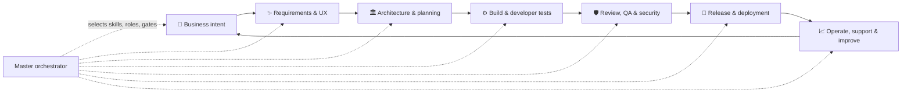
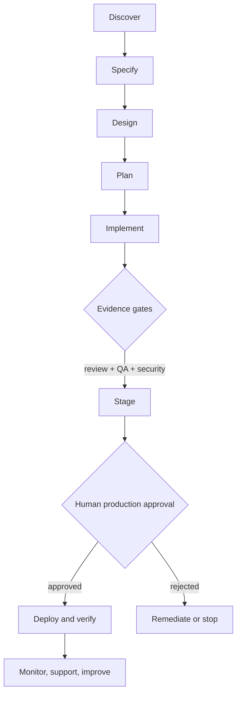
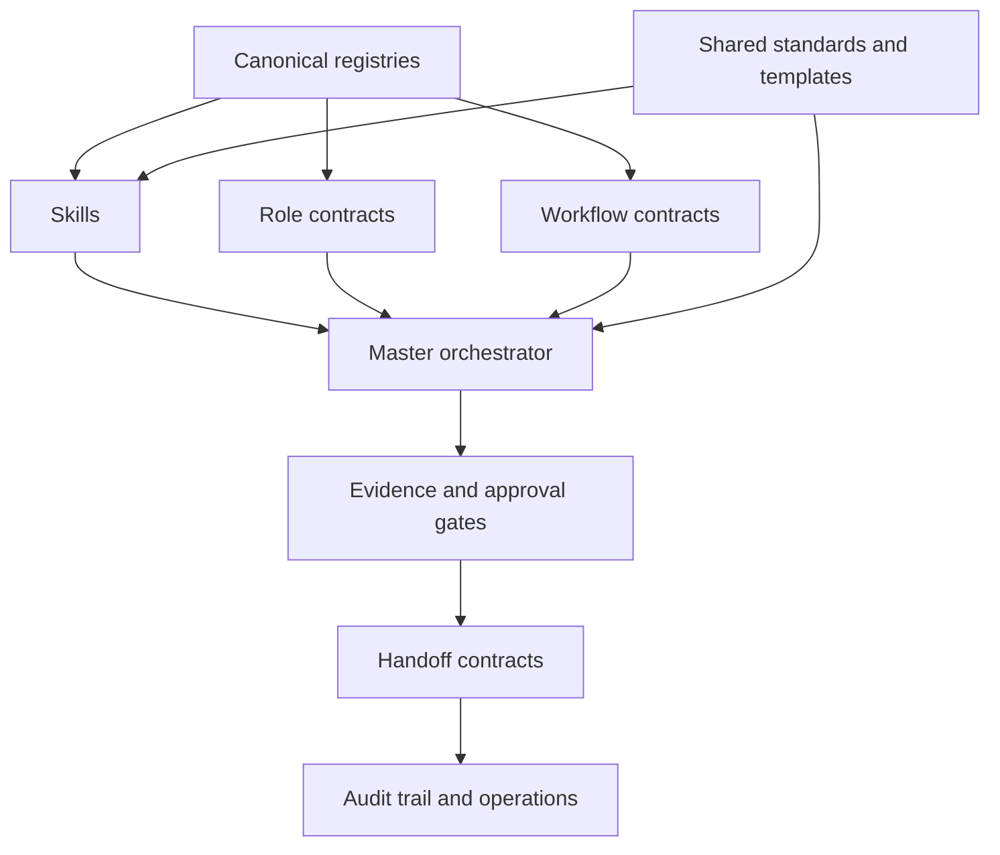

<div align="center">

# Enterprise Engineering Skills Library

### An evidence-driven operating system for AI-assisted software delivery

**From first business question to reliable production operations — with clear ownership, guardrails, and proof at every meaningful decision.**

[](../../actions/workflows/validate.yml)


**[Start here](docs/getting-started/GETTING_STARTED.md)** · **[Architecture](docs/architecture/OVERVIEW.md)** · **[Skills](#skill-domains)** · **[Workflows](#workflow-library)** · **[Security](docs/security/SECURITY_MODEL.md)**

</div>

---

## Why this exists

AI can write code quickly. Professional software teams still need answers to harder questions: **Who owns this decision? What was actually verified? Can we prove what changed? Is production safe to touch?**

This library turns those questions into a reusable operating system. It is not a giant prompt, and it never treats “tests passed” as proof without a report, exact revision, and accountable owner.

| Instead of… | This library provides… |
|---|---|
| Isolated coding prompts | Reusable skills linked to workflow stages and accountable roles |
| “Looks good” approvals | Structured gates with artifacts, limitations, and explicit decisions |
| One agent doing everything | Separation of implementation, review, verification, and authorization |
| Tool lock-in | Vendor-neutral contracts with platform adapters |
| A generic checklist | 190 traceable SDLC stage contracts |

## The delivery system



<details>
<summary><strong>What makes a stage complete?</strong></summary>

Every stage contains purpose, accountable role, supporting roles, inputs, procedure, outputs, deliverable artifacts, dependencies, quality criteria, validation method, handoff rule, approval requirement, skill mapping, agent mapping, and workflow mapping. A gate moves to `PASS` only with traceable evidence. Read the [gate policy](orchestrator/policies/GATE_POLICY.md).

</details>

## Skill domains

The overview skills stay focused. Their stage playbooks contain the detailed procedures, checks, outputs, and handoffs.

| Domain | Explore |
|---|---|
| 💼 Business & product | [Strategy to approved product direction](skills/business-product/business-product-management/references/STAGE_PLAYBOOK.md) |
| ✨ Requirements & design | [Requirements, UX, prototype, accessibility](skills/requirements-design/requirements-design/references/STAGE_PLAYBOOK.md) |
| 🏛️ Architecture | [Solution, application, data, API, cloud, security](skills/architecture/technical-architecture/references/STAGE_PLAYBOOK.md) |
| 📋 Delivery management | [Planning, risks, stakeholders, change](skills/project-management/project-agile-management/references/STAGE_PLAYBOOK.md) |
| 🧰 Engineering governance | [Repo, environments, secrets, standards](skills/engineering-governance/engineering-governance/references/STAGE_PLAYBOOK.md) |
| ⚙️ Software implementation | [Frontend, backend, APIs, data, testing](skills/development/software-implementation/references/STAGE_PLAYBOOK.md) |
| 🔍 Review & code quality | [PR review, static analysis, merge, debt](skills/code-review/code-review-quality/references/STAGE_PLAYBOOK.md) |
| 🧪 Quality assurance | [Unit through UAT and performance](skills/quality-assurance/quality-assurance/references/STAGE_PLAYBOOK.md) |
| 🛡️ Security & compliance | [Threat model, scans, remediation, sign-off](skills/security/application-security/references/STAGE_PLAYBOOK.md) |
| 🚀 DevOps & platform | [CI/CD, containers, IaC, automation](skills/devops-platform/devops-platform/references/STAGE_PLAYBOOK.md) |
| 📦 Release & deployment | [Staging, production, rollback, verification](skills/release-deployment/release-deployment/references/STAGE_PLAYBOOK.md) |
| ☁️ Cloud hosting | [Hosting, backup, resilience, cost](skills/cloud-hosting/cloud-hosting-operations/references/STAGE_PLAYBOOK.md) |
| 📈 SRE & observability | [Monitor, detect, respond, learn](skills/sre-observability/sre-observability/references/STAGE_PLAYBOOK.md) |
| 🔧 Maintenance & support | [Support, patches, lifecycle, feedback](skills/maintenance-support/maintenance-support/references/STAGE_PLAYBOOK.md) |
| 🏢 Enterprise governance | [Quality, security, audit, vendor, FinOps](skills/enterprise-governance/enterprise-governance/references/STAGE_PLAYBOOK.md) |

## Workflow library

`new-product-development` covers the complete 190-stage journey. Targeted workflows cover enhancements, bug fixes, hotfixes, vulnerability remediation, migrations, releases, rollback, incidents, disaster recovery, optimization, documentation, and retirement.



Explore every route in [`workflows/`](workflows) or the [workflow registry](registry/WORKFLOW_REGISTRY.yaml).

## Architecture at a glance



Read the [architecture overview](docs/architecture/OVERVIEW.md), [role operating model](agents/ROLE_OPERATING_MODEL.md), and [untrusted-content policy](orchestrator/policies/UNTRUSTED_CONTENT_POLICY.md).

## Evidence, not assertions

```json
{
  "gate_id": "QA-UNIT",
  "stage_id": 79,
  "status": "PASS",
  "commit_sha": "exact-commit-sha",
  "executed_by": "qa-agent",
  "evidence": [{ "type": "test-report", "path": "reports/unit-tests.xml", "result": "passed" }]
}
```

Use the [evidence record](templates/evidence-record.json), [handoff contract](orchestrator/handoff-contracts/STANDARD_HANDOFF.md), and [security standards](standards/SECURE_ENGINEERING_STANDARD.md).

## Quick start

```powershell
git clone https://github.com/kirubaharan181/enterprise-engineering-skills.git
cd enterprise-engineering-skills
python scripts/validate.py
python scripts/run_tests.py
```

Then choose a workflow, resolve its stage records, load only the needed skills, and attach evidence for every completed gate.

## Quality signals

| Signal | Current result |
|---|---|
| Required stages | **190 / 190 mapped** |
| Category skills | **15** |
| Cross-cutting control skills | **5** |
| Specialist role contracts | **74** |
| Workflow routes | **23** |
| Registry validation | **Passing locally** |
| Scenario fixtures | **3 controlled workflows** |

The library does **not** claim unexecuted production deployments, penetration tests, or untested platform support.

## Contribute

Improve a real contract: a skill, stage mapping, role boundary, workflow, template, or deterministic check. Read [Contributing](CONTRIBUTING.md) before opening a change.

## License

[MIT](LICENSE). External repositories informed general practices; this project contains independently written material and records research in [`research/`](research).
