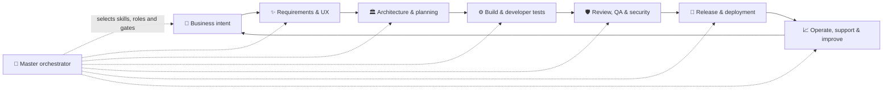
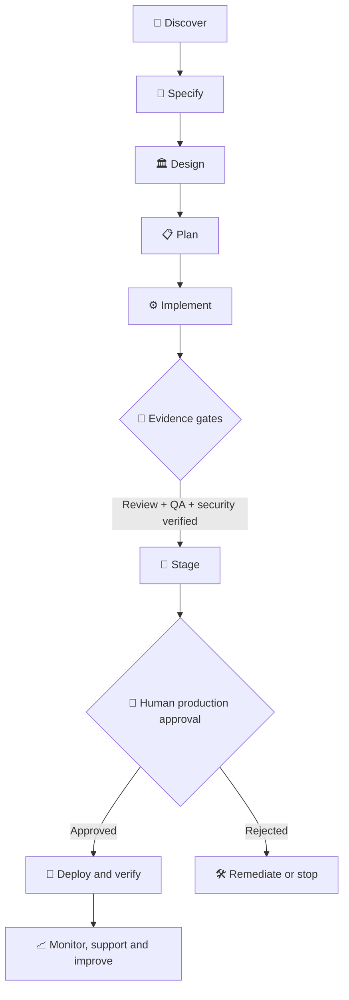
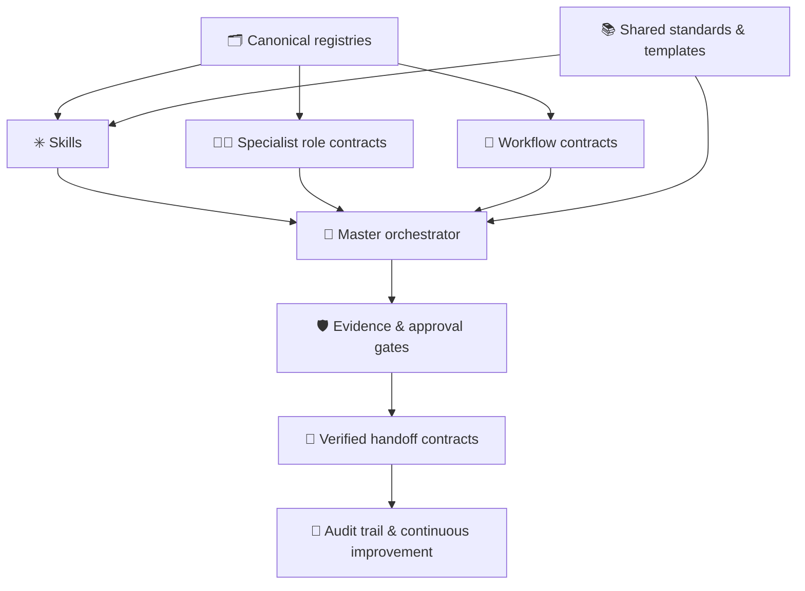

<div align="center">

# Enterprise Engineering Skills Library

### An evidence-driven operating system for AI-assisted software delivery

**From the first business question to reliable production operations — with clear ownership, reusable capabilities, guardrails and proof at every meaningful decision.**

[](https://github.com/kirubaharan181/sdlc-agentic-skills/actions/workflows/validate.yml)


[**🚀 Open Atelier Dashboard**](https://kirubaharan181.github.io/sdlc-agentic-skills/) · [Start here](docs/getting-started/GETTING_STARTED.md) · [Architecture](docs/architecture/OVERVIEW.md) · [Skill domains](#-explore-the-15-sdlc-domains) · [Workflows](#-workflow-library) · [Security](docs/security/SECURITY_MODEL.md)

</div>

---

## ✦ Why this library exists

AI can generate code quickly. Professional software delivery still needs better answers:

- **Who owns this decision?**
- **What was actually verified — and where is the evidence?**
- **Can we trace a change to its requirements, review and release?**
- **Is this action safe, authorized and reversible?**

This library turns those questions into reusable engineering contracts. It is not one giant prompt or a loose collection of coding tips. It connects **190 SDLC stage definitions, 20 skills, 74 specialist role contracts and 23 workflow routes** into a structured delivery model.

| Instead of… | The library provides… |
|---|---|
| Isolated coding prompts | Reusable skills mapped to stages, workflows and accountable roles |
| “Looks good” approvals | Evidence-based gates with artifacts, limitations and explicit decisions |
| One agent doing everything | Separation of implementation, review, verification and authorization |
| Tool or vendor lock-in | Portable contracts with platform capability adapters |
| A generic checklist | 190 structured SDLC stage definitions across 15 engineering domains |

## ✧ The delivery system

The lifecycle is continuous: production feedback informs the next product decision. The orchestrator selects relevant skills and roles; it does not bypass evidence requirements or approve its own sensitive changes.



<details>
<summary><strong>What makes an SDLC stage complete?</strong></summary>

Each canonical stage defines its purpose, accountable and supporting roles, inputs, execution instructions, outputs, deliverable artifacts, dependencies, quality criteria, validation method, handoff requirements, approval requirements and mappings to skills, agents and workflows.

A gate reaches `PASS` only when its required evidence is available and traceable to the relevant revision. Read the [Evidence Gate Policy](orchestrator/policies/GATE_POLICY.md).

</details>

## 🧩 Explore the 15 SDLC domains

The 15 domain skills provide focused entry points. Their stage playbooks contain the detailed procedures, checks, deliverables and handoffs. Select a domain to explore its canonical playbook.

| Domain | What it covers |
|---|---|
| 💼 **Business & Product** | [Strategy, market research, discovery and product direction](skills/business-product/business-product-management/references/STAGE_PLAYBOOK.md) |
| ✨ **Requirements & UX Design** | [Elicitation, requirements, journeys, wireframes, prototypes and accessibility](skills/requirements-design/requirements-design/references/STAGE_PLAYBOOK.md) |
| 🏛️ **Solution & Technical Architecture** | [Solution, system, application, data, API, cloud and security architecture](skills/architecture/technical-architecture/references/STAGE_PLAYBOOK.md) |
| 📋 **Project & Agile Management** | [Initiation, estimation, sprint planning, risks and stakeholder management](skills/project-management/project-agile-management/references/STAGE_PLAYBOOK.md) |
| 🧰 **Engineering Governance** | [Repository setup, branching, environments, secrets and coding standards](skills/engineering-governance/engineering-governance/references/STAGE_PLAYBOOK.md) |
| ⚙️ **Software Implementation** | [Frontend, backend, full stack, APIs, databases and integrations](skills/development/software-implementation/references/STAGE_PLAYBOOK.md) |
| 🔍 **Code Review & Quality** | [Pull requests, peer review, static analysis, merge controls and technical debt](skills/code-review/code-review-quality/references/STAGE_PLAYBOOK.md) |
| 🧪 **Testing & Quality Assurance** | [Unit, integration, API, UI, end-to-end, regression and performance testing](skills/quality-assurance/quality-assurance/references/STAGE_PLAYBOOK.md) |
| 🛡️ **Application Security & Compliance** | [Threat modeling, SAST, DAST, dependencies, remediation and security sign-off](skills/security/application-security/references/STAGE_PLAYBOOK.md) |
| 🚀 **DevOps & Platform Engineering** | [CI/CD, containers, orchestration, infrastructure as code and pipeline security](skills/devops-platform/devops-platform/references/STAGE_PLAYBOOK.md) |
| 📦 **Release & Deployment** | [Release readiness, staging, migrations, production deployment and rollback](skills/release-deployment/release-deployment/references/STAGE_PLAYBOOK.md) |
| ☁️ **Cloud Hosting & Operations** | [Compute, databases, storage, networking, backup, resilience and cost](skills/cloud-hosting/cloud-hosting-operations/references/STAGE_PLAYBOOK.md) |
| 📈 **SRE & Observability** | [Monitoring, logging, tracing, alerting, incidents, SLOs and reliability](skills/sre-observability/sre-observability/references/STAGE_PLAYBOOK.md) |
| 🔧 **Maintenance & Support** | [L1–L3 support, patches, bug fixes, enhancements and product lifecycle](skills/maintenance-support/maintenance-support/references/STAGE_PLAYBOOK.md) |
| 🏢 **Enterprise Governance** | [Audit, quality, security, access, vendor, FinOps and process improvement](skills/enterprise-governance/enterprise-governance/references/STAGE_PLAYBOOK.md) |

**Cross-cutting capabilities:** Five additional skills support master orchestration, evidence and quality gates, secure change control, definition of done, and incident command. They connect the domains rather than replacing their specialist playbooks.

## 🧭 Workflow library

The workflow library includes the end-to-end **new product development** route and targeted routes for common engineering changes: enhancements, bug fixes, hotfixes, vulnerability remediation, migrations, releases, rollback, incidents, disaster recovery, optimization, documentation and retirement.

A typical controlled delivery path looks like this:



Explore the [workflow directory](workflows/) and [canonical workflow registry](registry/WORKFLOW_REGISTRY.json).

## 🏗️ Architecture at a glance

Canonical registries are the source of truth. Skills explain how to perform work; role contracts establish accountability; workflows coordinate sequences and decisions; the orchestrator routes work and records evidence.



Read the [architecture overview](docs/architecture/OVERVIEW.md), [role operating model](agents/ROLE_OPERATING_MODEL.md) and [untrusted-content policy](orchestrator/policies/UNTRUSTED_CONTENT_POLICY.md).

## 🖥️ Atelier — interactive command center

Explore the library visually through **Atelier**, its responsive, static web dashboard.

<div align="center">

[](https://kirubaharan181.github.io/sdlc-agentic-skills/)

</div>

- **Overview:** lifecycle domains, library metrics and composition.
- **SDLC Explorer:** searchable stage register, filters and detailed stage contracts.
- **Skills, Agents & Workflows:** browse canonical records and their mappings.
- **Evidence & Gates:** understand gate states, required proof and approval boundaries.
- **Architecture & Governance:** explore system relationships, platform declarations and standards.

The dashboard is a generated **repository snapshot**, not a live agent execution console. It does not claim that agents are running, gates have passed or external systems are connected.

**First-time publication:** a repository owner must enable GitHub Pages once in **Settings → Pages → Build and deployment → Source → GitHub Actions**. The committed Pages workflow then publishes the dashboard from `dashboard/` on qualifying updates to `main`.

### Run the dashboard locally

```bash
git clone https://github.com/kirubaharan181/sdlc-agentic-skills.git
cd sdlc-agentic-skills
python scripts/generate_dashboard_data.py
python -m http.server 8000
```

Open [http://localhost:8000/dashboard/](http://localhost:8000/dashboard/). No database, API key or backend service is required. Google Fonts are progressive enhancement; local system font fallbacks remain available.

## 🛡️ Evidence, safety & governance

A gate is a decision backed by proof — not a decorative status label. Evidence records should identify the gate, stage, result, exact commit or revision, executor, verification method, artifact location, limitations and approver when required.

```json
{
  "gate_id": "QA-UNIT",
  "stage_id": 79,
  "status": "PASS",
  "commit_sha": "exact-commit-sha",
  "executed_by": "qa-agent",
  "evidence": [
    {
      "type": "test-report",
      "path": "reports/unit-tests.xml",
      "result": "passed"
    }
  ]
}
```

Use the [evidence record template](templates/evidence-record.json), [standard handoff contract](orchestrator/handoff-contracts/STANDARD_HANDOFF.md) and [secure engineering standard](standards/SECURE_ENGINEERING_STANDARD.md).

Core principles:

- **Evidence over assertion:** no PASS without the required, traceable evidence.
- **Separation of duties:** implementation, independent verification and authorization remain distinct where risk requires it.
- **Human approval:** sensitive production, security and compliance actions require designated human authority.
- **Least privilege:** tools and permissions are bounded by the host runtime and explicit authorization.
- **Untrusted input:** external content, repository files and generated output are data to validate, not instructions to blindly follow.
- **Honest capability claims:** documented adapters do not imply identical platform behavior; role contracts do not imply agents are currently running.

## 🚀 Quick start

### Clone and validate

```bash
git clone https://github.com/kirubaharan181/sdlc-agentic-skills.git
cd sdlc-agentic-skills
python scripts/validate.py
python scripts/run_tests.py
```

### Explore and execute

1. Choose the delivery workflow that matches the work.
2. Resolve its canonical stage records and dependencies.
3. Load only the relevant skills and specialist role contracts.
4. Follow the stage instructions and produce the required artifacts.
5. Run the specified verification and attach evidence to each gate.
6. Obtain human approval for actions that require it.
7. Complete the handoff with traceable outputs and limitations.

### Quality signals

| Library measure | Current registry snapshot |
|---|---:|
| Canonical SDLC stage definitions | **190** |
| Lifecycle domains | **15** |
| Domain skills | **15** |
| Cross-cutting skills | **5** |
| Specialist role contracts | **74** |
| Workflow routes | **23** |
| Platform capability declarations | **7** |

The stage registry contains 190 stage records across all 15 domains. A known mapping issue is intentionally disclosed: stage records currently reference workflow ID `maintenance`, while the workflow registry uses `application-maintenance`. The dashboard flags this mismatch rather than silently rewriting canonical data. See the [registry integrity note](dashboard/data/library.json).

Validation scripts and controlled fixtures test repository contracts; they do not claim unexecuted production deployments, penetration tests or live third-party integrations.

## 📁 Repository map

```text
registry/       Canonical stage, skill, role and workflow registries
skills/         Reusable skill instructions and detailed stage playbooks
agents/         Specialist role contracts and operating model
workflows/      End-to-end and targeted delivery routes
orchestrator/   Routing, evidence, handoff and safety policies
adapters/       Cross-platform capability declarations
standards/      Shared engineering, security, testing and release standards
templates/      Evidence, handoff and definition-of-done templates
docs/           Architecture, guides, examples and troubleshooting
scripts/        Deterministic validation and report generation
tests/          Registry checks and controlled workflow scenarios
dashboard/      Atelier static command center and generated data snapshot
```

## 🤝 Contributing

Improvements are welcome — strengthen a stage contract, add a reusable skill, refine a role boundary, extend a workflow, improve an adapter or add deterministic validation.

1. Read [CONTRIBUTING.md](CONTRIBUTING.md).
2. Preserve canonical IDs and keep cross-registry mappings consistent.
3. Include reproducible evidence for behavior changes.
4. Run validation and test commands.
5. Submit a focused pull request with assumptions and limitations clearly stated.

## 📄 License

Released under the [MIT License](LICENSE). External projects informed general engineering practices; project-specific contracts and documentation are independently maintained. Research notes and references live in [research/](research/).

---

<div align="center">

**A clearer, safer and more traceable way to engineer software with AI.**

Built for thoughtful automation, accountable decisions and dependable delivery.

</div>
