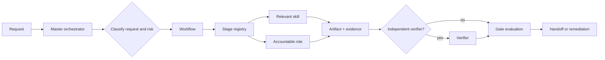

# Architecture Overview

## One source of truth, many useful views

Canonical registries ensure a stage cannot mean different things in a skill, role card, workflow, and report. Markdown keeps the library approachable; structured records make it verifiable.

## Layer responsibilities

| Layer | Owns | Never owns |
|---|---|---|
| Registry | IDs, mappings, traceability | Live credentials or production access |
| Skill | Execution method and constraints | Authorization outside scope |
| Agent | Role boundary and escalation | Blanket permissions |
| Workflow | Ordering, gates, recovery | Replacing specialist judgment |
| Orchestrator | Routing and evidence state | Self-approval or hidden waiver |
| Standards | Shared engineering rules | Project implementation choices |

## Core design choices

1. **Progressive disclosure:** README → skill → stage playbook → template/reference.
2. **Evidence over narrative:** a claim includes revision, report, executor, timestamp, and limitation.
3. **Separation of duties:** implementation, verification, and authorization split when risk requires it.
4. **Vendor neutrality:** operating logic is separate from adapters and tool catalogues.
5. **Safe defaults:** sensitive actions stop at `NEEDS_HUMAN_APPROVAL`.

The [stage registry](../../registry/SDLC_STAGE_REGISTRY.json) is JSON, parseable with standard tooling and dependency-free validation.
