# Skill selection, responsibilities and handoffs

Generated by `python3 scripts/build.py` from `registry/skill-content/*.json`. Do not edit by hand.

## 1. Choose a skill

Use `python3 scripts/select_skill.py "<request>"` for a ranked suggestion. It matches words, not meaning, so confirm the result.
Use `master-orchestration` when a request spans several skills. If a request clearly fits one skill, use that skill directly.

| If the request is about | Use | Not this (use instead) |
|---|---|---|
| A feature or architecture needs a threat model | `application-security` | Operating cloud accounts and networks: use cloud-hosting-operations |
| A new product, feature or client request needs a business case before requirements are written | `business-product-management` | Writing testable requirements or designs: use requirements-design |
| Cloud resources need managing, patching or right-sizing | `cloud-hosting-operations` | Building pipelines: use devops-platform |
| A pull request needs review before merge | `code-review-quality` | Implementing the change: use software-implementation |
| A task is about to be reported done | `definition-of-done` | Planning or doing the work: use the stage skill |
| A pipeline, build or deployment automation is needed or fails | `devops-platform` | Approving a release: use release-deployment |
| A repository, branching model or development environment must be set up | `engineering-governance` | Organization-wide audit and policy: use enterprise-governance |
| Policies need turning into testable controls and measured compliance | `enterprise-governance` | Doing the audited work itself: use the specialist skill |
| A gate, sign-off or approval depends on evidence | `evidence-quality-gates` | Producing the evidence: use the specialist skill |
| An incident is declared or a service is failing and impact is unclear | `incident-command` | Routine tickets: use maintenance-support |
| Support requests, bugs or patches need handling | `maintenance-support` | Building a new product: use requirements-design and software-implementation |
| A request spans several stages or skills, such as 'ship this feature safely' | `master-orchestration` | The request clearly fits one skill: invoke that skill directly |
| A project needs a charter, work breakdown, estimate or plan | `project-agile-management` | Writing requirements: use requirements-design |
| A test strategy or plan is needed for a release | `quality-assurance` | Fixing defects: use software-implementation |
| A release needs planning, readiness review or notes | `release-deployment` | Creating the pipeline itself: use devops-platform |
| Stakeholder needs must be captured as requirements with acceptance criteria | `requirements-design` | Deciding system structure or technology: use technical-architecture |
| A change to production, infrastructure, access or security controls is proposed | `secure-change-control` | Finding vulnerabilities in code: use application-security |
| Approved requirements and designs need to be implemented | `software-implementation` | Deciding architecture: use technical-architecture |
| A service needs monitoring, logging, tracing or alerts | `sre-observability` | Commanding an active severe incident: use incident-command |
| A new system or major change needs structure, interfaces and quality targets designed | `technical-architecture` | Writing or changing feature code: use software-implementation |

## 2. Responsibility matrix

Each responsibility has exactly one owning skill; `scripts/validate.py` fails on a duplicate.

| Skill | Stages | Owns |
|---|---|---|
| `application-security` | 98-110 | threat-modeling-and-appsec-testing, vulnerability-remediation-tracking, security-signoff |
| `business-product-management` | 1-10 | business-case-and-approval, market-and-feasibility-analysis, contract-obligation-intake |
| `cloud-hosting-operations` | 140-152 | cloud-resource-operations, backup-and-disaster-recovery, cloud-cost-optimization |
| `code-review-quality` | 68-76 | peer-and-pull-request-review, static-analysis-and-dependency-review, technical-debt-review |
| `definition-of-done` | cross-cutting | completion-criteria-and-closure |
| `devops-platform` | 111-125 | ci-cd-pipeline-engineering, container-and-iac-definitions, environment-provisioning |
| `engineering-governance` | 45-52 | repository-and-branching-controls, dev-environment-and-coding-standards, configuration-and-secrets-design |
| `enterprise-governance` | 181-190 | governance-oversight-and-audit, access-and-vendor-governance, process-improvement-governance |
| `evidence-quality-gates` | cross-cutting | evidence-evaluation-and-confidence |
| `incident-command` | cross-cutting | active-incident-coordination |
| `maintenance-support` | 167-180 | support-triage-and-fixing, patch-and-dependency-maintenance, product-lifecycle-decisions |
| `master-orchestration` | cross-cutting | request-routing-and-workflow-selection, cross-skill-handoff-tracking |
| `project-agile-management` | 35-44 | delivery-planning-and-estimation, risk-and-stakeholder-management, iteration-flow-management |
| `quality-assurance` | 77-97 | test-strategy-and-execution, defect-management, test-signoff |
| `release-deployment` | 126-139 | release-planning-and-approval, deployment-verification-and-rollback, migration-and-cutover-planning |
| `requirements-design` | 11-22 | requirements-elicitation-and-baseline, user-research-and-ux-design, accessibility-requirements |
| `secure-change-control` | cross-cutting | change-risk-classification-and-approval |
| `software-implementation` | 53-67 | feature-and-fix-implementation, api-and-schema-implementation, implementation-error-handling |
| `sre-observability` | 153-166 | monitoring-and-slo-design, incident-detection-and-rca, capacity-planning |
| `technical-architecture` | 23-34 | system-and-solution-design, technology-selection, architecture-decision-records |

## 3. Dependency graph

Solid arrows are the forward flow and must stay acyclic. Dashed arrows are feedback loops such as rework or learning.

```mermaid
flowchart LR
  application_security["application-security"]
  business_product_management["business-product-management"]
  cloud_hosting_operations["cloud-hosting-operations"]
  code_review_quality["code-review-quality"]
  definition_of_done["definition-of-done"]
  devops_platform["devops-platform"]
  engineering_governance["engineering-governance"]
  enterprise_governance["enterprise-governance"]
  evidence_quality_gates["evidence-quality-gates"]
  incident_command["incident-command"]
  maintenance_support["maintenance-support"]
  master_orchestration["master-orchestration"]
  project_agile_management["project-agile-management"]
  quality_assurance["quality-assurance"]
  release_deployment["release-deployment"]
  requirements_design["requirements-design"]
  secure_change_control["secure-change-control"]
  software_implementation["software-implementation"]
  sre_observability["sre-observability"]
  technical_architecture["technical-architecture"]
  application_security --> enterprise_governance
  application_security --> release_deployment
  application_security -.-> software_implementation
  business_product_management --> enterprise_governance
  business_product_management --> project_agile_management
  business_product_management --> requirements_design
  cloud_hosting_operations --> enterprise_governance
  cloud_hosting_operations --> maintenance_support
  cloud_hosting_operations --> sre_observability
  code_review_quality -.-> engineering_governance
  code_review_quality --> quality_assurance
  code_review_quality -.-> software_implementation
  definition_of_done --> evidence_quality_gates
  definition_of_done --> release_deployment
  devops_platform --> application_security
  devops_platform --> cloud_hosting_operations
  devops_platform --> release_deployment
  engineering_governance --> devops_platform
  engineering_governance --> enterprise_governance
  engineering_governance --> software_implementation
  enterprise_governance -.-> engineering_governance
  enterprise_governance -.-> evidence_quality_gates
  enterprise_governance -.-> project_agile_management
  evidence_quality_gates --> enterprise_governance
  evidence_quality_gates --> release_deployment
  incident_command --> maintenance_support
  incident_command -.-> secure_change_control
  incident_command -.-> sre_observability
  maintenance_support --> enterprise_governance
  maintenance_support -.-> software_implementation
  maintenance_support -.-> sre_observability
  master_orchestration --> definition_of_done
  master_orchestration --> evidence_quality_gates
  master_orchestration --> incident_command
  master_orchestration --> secure_change_control
  project_agile_management --> enterprise_governance
  project_agile_management --> release_deployment
  project_agile_management --> software_implementation
  quality_assurance --> enterprise_governance
  quality_assurance --> release_deployment
  quality_assurance -.-> software_implementation
  release_deployment --> cloud_hosting_operations
  release_deployment --> maintenance_support
  release_deployment --> sre_observability
  requirements_design --> quality_assurance
  requirements_design --> software_implementation
  requirements_design --> technical_architecture
  secure_change_control --> enterprise_governance
  secure_change_control --> release_deployment
  software_implementation --> application_security
  software_implementation --> code_review_quality
  software_implementation --> quality_assurance
  sre_observability --> enterprise_governance
  sre_observability --> incident_command
  sre_observability --> maintenance_support
  technical_architecture --> application_security
  technical_architecture --> cloud_hosting_operations
  technical_architecture --> software_implementation
```

## 4. Handoff matrix

| From | To | Artifact handed over | Type |
|---|---|---|---|
| `application-security` | `enterprise-governance` | security evidence for audit | forward |
| `application-security` | `release-deployment` | security sign-off and open accepted risks | forward |
| `application-security` | `software-implementation` | remediation items with severity | feedback |
| `business-product-management` | `enterprise-governance` | contract and compliance obligations register | forward |
| `business-product-management` | `project-agile-management` | approved project charter inputs and budget | forward |
| `business-product-management` | `requirements-design` | approved business case, goals, scope and constraints | forward |
| `cloud-hosting-operations` | `enterprise-governance` | cost and resource evidence | forward |
| `cloud-hosting-operations` | `maintenance-support` | infrastructure maintenance windows | forward |
| `cloud-hosting-operations` | `sre-observability` | infrastructure telemetry and capacity data | forward |
| `code-review-quality` | `engineering-governance` | recurring findings as proposed rules | feedback |
| `code-review-quality` | `quality-assurance` | approved change with review findings | forward |
| `code-review-quality` | `software-implementation` | blocker findings for rework | feedback |
| `definition-of-done` | `evidence-quality-gates` | evidence sets that need deeper evaluation | forward |
| `definition-of-done` | `release-deployment` | completion statement for release readiness | forward |
| `devops-platform` | `application-security` | pipeline findings for review | forward |
| `devops-platform` | `cloud-hosting-operations` | infrastructure definitions | forward |
| `devops-platform` | `release-deployment` | deployable artifacts and pipeline run records | forward |
| `engineering-governance` | `devops-platform` | repository and configuration conventions for pipelines | forward |
| `engineering-governance` | `enterprise-governance` | repository control inventory | forward |
| `engineering-governance` | `software-implementation` | repository standards, branching rules and environment | forward |
| `enterprise-governance` | `engineering-governance` | policy requirements and control gaps | feedback |
| `enterprise-governance` | `evidence-quality-gates` | evidence sets for quality evaluation | feedback |
| `enterprise-governance` | `project-agile-management` | improvement actions for planning | feedback |
| `evidence-quality-gates` | `enterprise-governance` | evidence assessments for audits | forward |
| `evidence-quality-gates` | `release-deployment` | gate decisions for release readiness | forward |
| `incident-command` | `maintenance-support` | customer communications and follow-up tickets | forward |
| `incident-command` | `secure-change-control` | emergency change requests | feedback |
| `incident-command` | `sre-observability` | timeline and decision log for root cause analysis | feedback |
| `maintenance-support` | `enterprise-governance` | patch and lifecycle evidence | forward |
| `maintenance-support` | `software-implementation` | defects and enhancements with reproduction steps | feedback |
| `maintenance-support` | `sre-observability` | recurring issues as reliability work | feedback |
| `master-orchestration` | `definition-of-done` | task completion check | forward |
| `master-orchestration` | `evidence-quality-gates` | evidence set for evaluation | forward |
| `master-orchestration` | `incident-command` | active incident declaration with severity | forward |
| `master-orchestration` | `secure-change-control` | change requests needing classification | forward |
| `project-agile-management` | `enterprise-governance` | change and risk records for audit | forward |
| `project-agile-management` | `release-deployment` | release scope and dependency list | forward |
| `project-agile-management` | `software-implementation` | sprint backlog with acceptance criteria | forward |
| `quality-assurance` | `enterprise-governance` | test evidence for quality audits | forward |
| `quality-assurance` | `release-deployment` | test sign-off with exit criteria scorecard | forward |
| `quality-assurance` | `software-implementation` | defect reports with evidence | feedback |
| `release-deployment` | `cloud-hosting-operations` | deployed release and environment changes | forward |
| `release-deployment` | `maintenance-support` | release notes and known issues | forward |
| `release-deployment` | `sre-observability` | release markers and rollback criteria for monitoring | forward |
| `requirements-design` | `quality-assurance` | acceptance criteria and risk list for test design | forward |
| `requirements-design` | `software-implementation` | wireframes, UI designs and acceptance criteria | forward |
| `requirements-design` | `technical-architecture` | validated requirements including non-functional targets | forward |
| `secure-change-control` | `enterprise-governance` | change records and exceptions for audit | forward |
| `secure-change-control` | `release-deployment` | approved change with window and rollback | forward |
| `software-implementation` | `application-security` | code and dependency changes for scanning | forward |
| `software-implementation` | `code-review-quality` | pull request with tests and notes | forward |
| `software-implementation` | `quality-assurance` | build and acceptance criteria for testing | forward |
| `sre-observability` | `enterprise-governance` | SLO and incident evidence for review | forward |
| `sre-observability` | `incident-command` | severity and detection data when an incident is declared | forward |
| `sre-observability` | `maintenance-support` | reliability and fix backlog | forward |
| `technical-architecture` | `application-security` | architecture and data flows for threat modeling | forward |
| `technical-architecture` | `cloud-hosting-operations` | cloud design and recovery objectives | forward |
| `technical-architecture` | `software-implementation` | decision records, interface contracts and dependency rules | forward |

Each handoff follows [the handoff contract standard](../governance/HANDOFF_CONTRACT_STANDARD.md).
