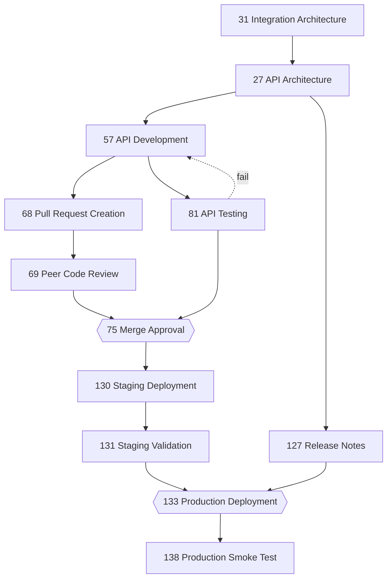

# API version upgrade

> Generated from `registry/workflows/api-version-upgrade.json`. Edit the source, then run `python scripts/build.py`.

**Purpose.** Introduce a new API version with contract tests for old and new versions and a deprecation path.

**Trigger.** An API change is breaking, or a new version is required.

## Entry criteria
- Current API contract is published
- Consumers are known or discoverable from gateway logs

## Required inputs
- current_api_contract
- change_description
- consumer_inventory

## Flow

Solid arrows are dependencies, dotted arrows are decisions and failure paths, hexagons need human approval.

## Steps

| # | Stage | Owner (accountable or responsible) | Needs | Notes |
|---:|---|---|---|---|
| 31 | Integration Architecture | `integration-architect` | - | Inventory consumers and agree the deprecation window. |
| 27 | API Architecture | `api-architect` | 31 |  |
| 57 | API Development | `api-engineer` | 27 |  |
| 81 | API Testing | `api-testing-specialist` | 57 | Contract tests against both versions. |
| 68 | Pull Request Creation | `full-stack-engineer` | 57 |  |
| 69 | Peer Code Review | `code-reviewer` | 68 |  |
| 75 | Merge Approval | `merge-steward` | 69, 81 | approval: code-owner |
| 127 | Release Notes | `technical-writer` | 27 | Migration guide and deprecation notice. |
| 130 | Staging Deployment | `deployment-engineer` | 75 |  |
| 131 | Staging Validation | `qa-lead` | 130 |  |
| 133 | Production Deployment | `deployment-engineer` | 131, 127 | approval: production-approver |
| 138 | Production Smoke Test | `sre` | 133 |  |

## Parallel work
- Stages 57, 127
- Stages 68, 81

## Human approval points

| Stage | Approver | When |
|---:|---|---|
| 75 Merge Approval | `code-owner` | always |
| 133 Production Deployment | `production-approver` | always |

Rationale for each approval is in `docs/governance/APPROVAL_POLICY.md` and the stage's `approval_rationale`.

## Failure and remediation

| At stage | Condition | Action | Go to |
|---:|---|---|---|
| 81 | Old-version contract test fails | The change is breaking by accident; fix before release | 57 |

## Outputs
- versioned_api_contract
- migration_guide
- contract_test_report

## Exit criteria
- Old version still passes its contract tests
- New version passes its contract tests
- Deprecation date and migration guide published

## Communication
Email registered consumers with the timeline.

Any FAIL, BLOCKED or INCONCLUSIVE gate halts the steps that depend on it; see `orchestrator/` for the common failure policy.
