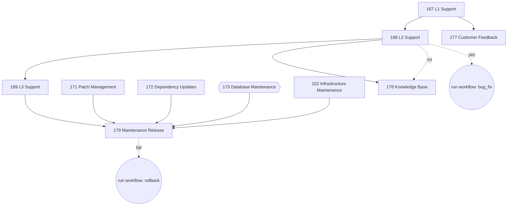

# Application maintenance

> Generated from `registry/workflows/application-maintenance.json`. Edit the source, then run `python scripts/build.py`.

**Purpose.** Run routine support, patching, dependency, database and infrastructure upkeep for a released product.

**Trigger.** The product is in production and enters or continues its maintenance cycle.

## Entry criteria
- Support tiers and SLAs are defined

## Required inputs
- support_queue
- patch_advisories
- maintenance_calendar

## Flow

Solid arrows are dependencies, dotted arrows are decisions and failure paths, hexagons need human approval.

## Steps

| # | Stage | Owner (accountable or responsible) | Needs | Notes |
|---:|---|---|---|---|
| 167 | L1 Support | `technical-support-engineer` | - |  |
| 168 | L2 Support | `production-support-engineer` | 167 |  |
| 169 | L3 Support | `backend-engineer` | 168 |  |
| 171 | Patch Management | `devops-engineer` | - |  |
| 172 | Dependency Updates | `backend-engineer` | - |  |
| 173 | Database Maintenance | `database-administrator` | - | approval: dba-owner |
| 152 | Infrastructure Maintenance | `infrastructure-engineer` | - |  |
| 177 | Customer Feedback | `product-manager` | 167 |  |
| 178 | Knowledge Base | `technical-writer` | 168 |  |
| 179 | Maintenance Release | `release-manager` | 169, 171, 172, 173, 152 |  |

## Parallel work
- Stages 152, 167, 171, 172, 173
- Stages 168, 177
- Stages 169, 178

## Human approval points

| Stage | Approver | When |
|---:|---|---|
| 173 Database Maintenance | `dba-owner` | for destructive or locking maintenance on production data |

Rationale for each approval is in `docs/governance/APPROVAL_POLICY.md` and the stage's `approval_rationale`.

## Decision points
- After 168 - Is it a code defect? **yes** -> workflow:bug-fix; **no** -> 178

## Failure and remediation

| At stage | Condition | Action | Go to |
|---:|---|---|---|
| 179 | Maintenance release fails verification | Rollback and reschedule | workflow:rollback |

## Outputs
- maintenance_release_record
- patch_records
- knowledge_base_articles

## Exit criteria
- Support SLAs met
- Patches current within policy
- Knowledge base updated from resolved tickets

## Communication
Monthly maintenance report to the product owner.

## Hands off to
- [bug-fix](bug-fix.md)
- [dependency-update](dependency-update.md)
- [rollback](rollback.md)

Any FAIL, BLOCKED or INCONCLUSIVE gate halts the steps that depend on it; see `orchestrator/` for the common failure policy.
