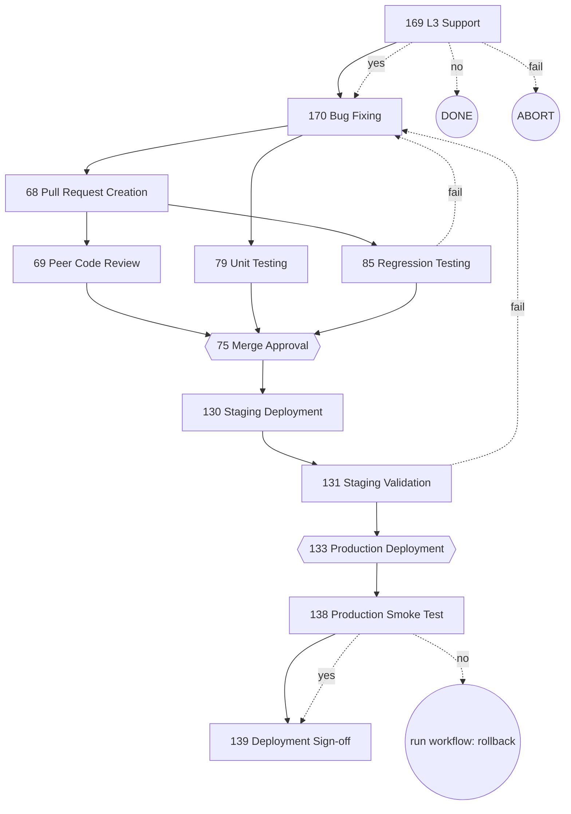

# Bug fix

> Generated from `registry/workflows/bug-fix.json`. Edit the source, then run `python scripts/build.py`.

**Purpose.** Fix a reproducible defect with the smallest safe change and prove it with a regression test.

**Trigger.** A defect is triaged by support or QA and recorded with a severity below Sev1.

## Entry criteria
- Defect recorded with severity, affected version and steps from L1/L2 support
- No active Sev1 incident (otherwise use emergency-hotfix)

## Required inputs
- defect_report
- affected_version
- reproduction_steps

## Flow

Solid arrows are dependencies, dotted arrows are decisions and failure paths, hexagons need human approval.

## Steps

| # | Stage | Owner (accountable or responsible) | Needs | Notes |
|---:|---|---|---|---|
| 169 | L3 Support | `backend-engineer` | - | Reproduce and isolate; write the failing test first. |
| 170 | Bug Fixing | `backend-engineer` | 169 |  |
| 79 | Unit Testing | `unit-testing-specialist` | 170 | Confirm the new test fails on the old code and passes on the fix. |
| 68 | Pull Request Creation | `full-stack-engineer` | 170 |  |
| 69 | Peer Code Review | `code-reviewer` | 68 |  |
| 85 | Regression Testing | `automation-qa-engineer` | 68 |  |
| 75 | Merge Approval | `merge-steward` | 69, 79, 85 | approval: code-owner |
| 130 | Staging Deployment | `deployment-engineer` | 75 |  |
| 131 | Staging Validation | `qa-lead` | 130 |  |
| 133 | Production Deployment | `deployment-engineer` | 131 | approval: production-approver |
| 138 | Production Smoke Test | `sre` | 133 |  |
| 139 | Deployment Sign-off | `release-manager` | 138 |  |

## Parallel work
- Stages 68, 79
- Stages 69, 85

## Human approval points

| Stage | Approver | When |
|---:|---|---|
| 75 Merge Approval | `code-owner` | always |
| 133 Production Deployment | `production-approver` | always |

Rationale for each approval is in `docs/governance/APPROVAL_POLICY.md` and the stage's `approval_rationale`.

## Decision points
- After 169 - Can the defect be reproduced? **yes** -> 170; **no** -> end
- After 138 - Did the production smoke test pass? **yes** -> 139; **no** -> workflow:rollback

## Failure and remediation

| At stage | Condition | Action | Go to |
|---:|---|---|---|
| 169 | Not reproducible after two attempts with the reporter's data | Mark the defect NEEDS_INFO, return it to L2 support with what was tried | abort |
| 85 | Regression suite fails | Return to 170; do not weaken or skip the failing test | 170 |
| 131 | Staging validation fails | Return to 170 with the staging evidence attached | 170 |

## Outputs
- merged_fix_pr
- regression_test
- regression_report
- production_smoke_report

## Exit criteria
- Failing test from step 169 is in the suite and passes on the release commit
- Regression suite passes on the merge commit
- Production smoke test passes for the released artifact version
- Defect closed with link to the PR and release

## Communication
Update the reporter after reproduction (169) and after release (139); post in the support channel when the fix ships.

## Hands off to
- [rollback](rollback.md)

Any FAIL, BLOCKED or INCONCLUSIVE gate halts the steps that depend on it; see `orchestrator/` for the common failure policy.
