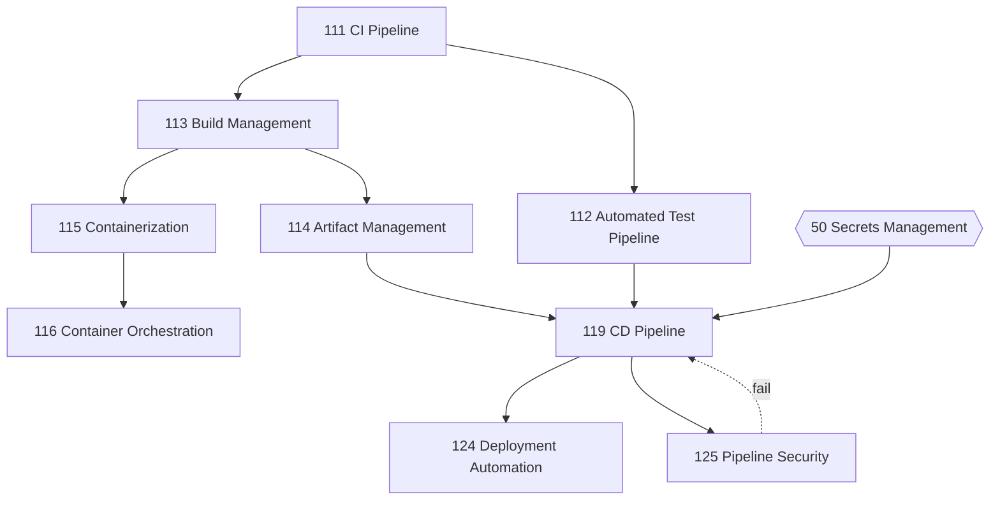

# CI/CD pipeline creation

> Generated from `registry/workflows/ci-cd-pipeline-creation.json`. Edit the source, then run `python scripts/build.py`.

**Purpose.** Build secure CI and CD pipelines with gated deployments.

**Trigger.** A repository needs build, test or deploy automation.

## Entry criteria
- Repository and branch protection exist
- Test commands are known

## Required inputs
- repository
- test_plan
- target_environments

## Flow

Solid arrows are dependencies, dotted arrows are decisions and failure paths, hexagons need human approval.

## Steps

| # | Stage | Owner (accountable or responsible) | Needs | Notes |
|---:|---|---|---|---|
| 50 | Secrets Management | `devsecops-engineer` | - | Pipeline secrets via the secret store.; approval: secrets-owner |
| 111 | CI Pipeline | `devops-engineer` | - |  |
| 112 | Automated Test Pipeline | `devops-engineer` | 111 |  |
| 113 | Build Management | `devops-engineer` | 111 |  |
| 114 | Artifact Management | `platform-engineer` | 113 |  |
| 115 | Containerization | `devops-engineer` | 113 | optional |
| 116 | Container Orchestration | `kubernetes-engineer` | 115 | optional |
| 119 | CD Pipeline | `devops-engineer` | 114, 112, 50 |  |
| 124 | Deployment Automation | `deployment-engineer` | 119 |  |
| 125 | Pipeline Security | `devsecops-engineer` | 119 |  |

## Parallel work
- Stages 50, 111
- Stages 112, 113
- Stages 114, 115
- Stages 116, 119
- Stages 124, 125

## Human approval points

| Stage | Approver | When |
|---:|---|---|
| 50 Secrets Management | `secrets-owner` | when rotating or revoking production secrets |

Rationale for each approval is in `docs/governance/APPROVAL_POLICY.md` and the stage's `approval_rationale`.

## Failure and remediation

| At stage | Condition | Action | Go to |
|---:|---|---|---|
| 125 | Pipeline can write to production without approval | Block until the approval gate is added | 119 |

## Outputs
- ci_pipeline_definition
- cd_pipeline_definition
- pipeline_security_review

## Exit criteria
- Pipeline runs green on a sample commit
- Production deploy stage requires approval
- Least-privilege tokens; pinned actions or images

## Communication
Document how to run and debug the pipeline.

Any FAIL, BLOCKED or INCONCLUSIVE gate halts the steps that depend on it; see `orchestrator/` for the common failure policy.
