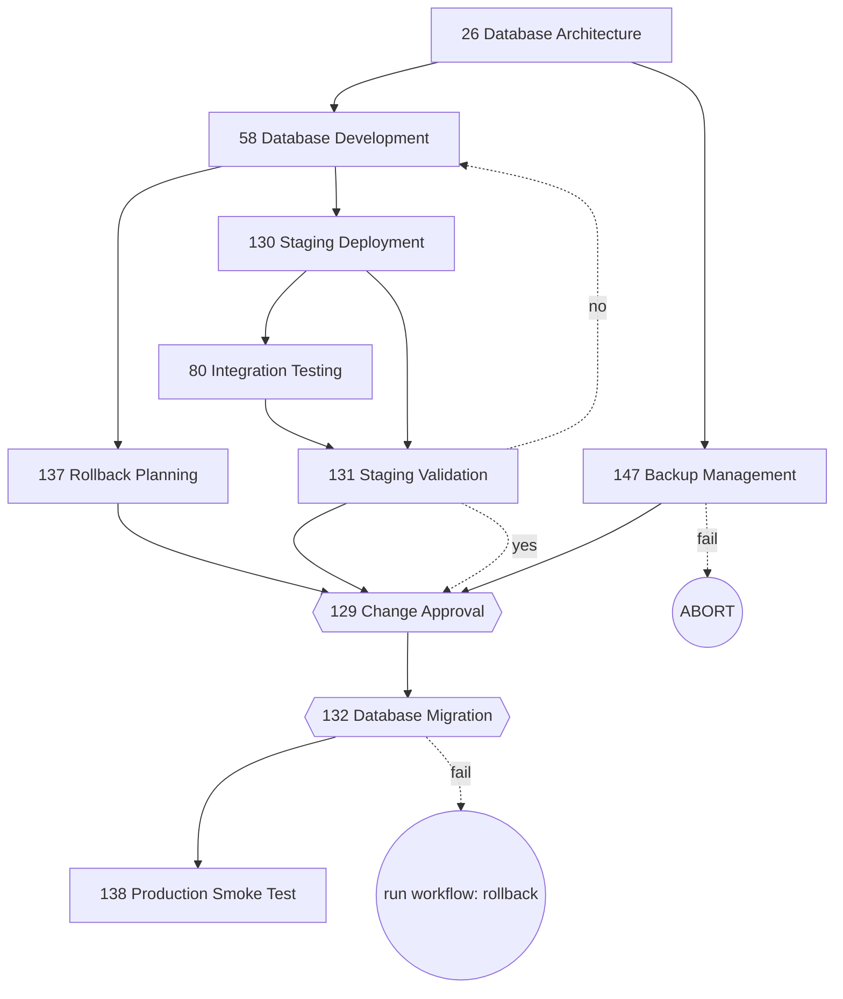

# Database migration

> Generated from `registry/workflows/database-migration.json`. Edit the source, then run `python scripts/build.py`.

**Purpose.** Change a schema or data safely with a verified backup, a rehearsed migration and a way back.

**Trigger.** A schema or data change is required by a feature, fix or maintenance task.

## Entry criteria
- Migration scripts are forward and reversible, or an irreversible step is explicitly flagged
- A staging environment with production-like data shape exists

## Required inputs
- migration_scripts
- rollback_plan
- maintenance_window

## Flow

Solid arrows are dependencies, dotted arrows are decisions and failure paths, hexagons need human approval.

## Steps

| # | Stage | Owner (accountable or responsible) | Needs | Notes |
|---:|---|---|---|---|
| 26 | Database Architecture | `database-architect` | - | Confirm the target design and compatibility with running code. |
| 58 | Database Development | `database-engineer` | 26 |  |
| 147 | Backup Management | `database-administrator` | 26 | Take and verify a restorable backup. |
| 137 | Rollback Planning | `release-manager` | 58 |  |
| 130 | Staging Deployment | `deployment-engineer` | 58 | Apply the migration to staging. |
| 80 | Integration Testing | `integration-testing-specialist` | 130 |  |
| 131 | Staging Validation | `qa-lead` | 130, 80 |  |
| 129 | Change Approval | `release-manager` | 131, 147, 137 | approval: change-board |
| 132 | Database Migration | `database-administrator` | 129 | Production migration inside the window.; approval: dba-owner |
| 138 | Production Smoke Test | `sre` | 132 |  |

## Parallel work
- Stages 58, 147
- Stages 130, 137

## Human approval points

| Stage | Approver | When |
|---:|---|---|
| 129 Change Approval | `change-board` | always |
| 132 Database Migration | `dba-owner` | always |

Rationale for each approval is in `docs/governance/APPROVAL_POLICY.md` and the stage's `approval_rationale`.

## Decision points
- After 131 - Did staging validation pass? **yes** -> 129; **no** -> 58

## Failure and remediation

| At stage | Condition | Action | Go to |
|---:|---|---|---|
| 132 | Migration fails or exceeds the window | Stop at a safe point, run the rehearsed rollback, notify the DBA owner | workflow:rollback |
| 147 | Backup cannot be restored | Do not proceed to production | abort |

## Outputs
- migration_execution_record
- backup_verification
- staging_validation_report
- rollback_plan

## Exit criteria
- Backup restore was tested
- Staging migration and rollback both rehearsed
- Production migration completed with row counts and constraints verified
- Application health checks pass

## Communication
Announce the window to affected teams; confirm completion to the change board.

## Hands off to
- [rollback](rollback.md)

Any FAIL, BLOCKED or INCONCLUSIVE gate halts the steps that depend on it; see `orchestrator/` for the common failure policy.
