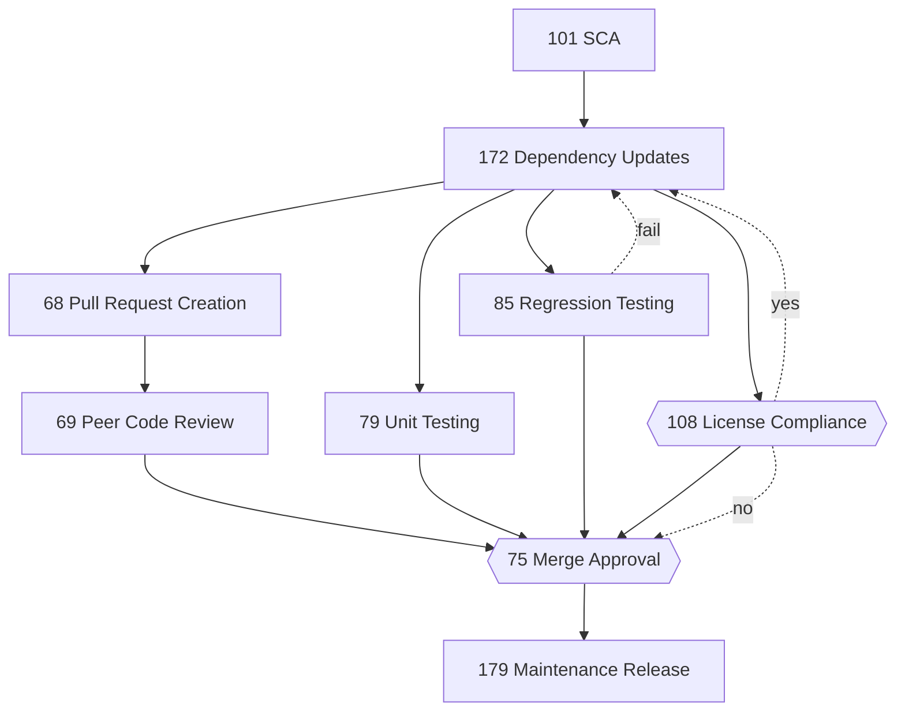

# Dependency update

> Generated from `registry/workflows/dependency-update.json`. Edit the source, then run `python scripts/build.py`.

**Purpose.** Upgrade packages with vulnerability, compatibility and license checks.

**Trigger.** An advisory, scheduled update or end-of-life notice affects a dependency.

## Entry criteria
- Dependency manifests and lockfiles are current in the repository

## Required inputs
- dependency_manifests
- advisory_or_reason

## Flow

Solid arrows are dependencies, dotted arrows are decisions and failure paths, hexagons need human approval.

## Steps

| # | Stage | Owner (accountable or responsible) | Needs | Notes |
|---:|---|---|---|---|
| 101 | SCA | `devsecops-engineer` | - |  |
| 172 | Dependency Updates | `backend-engineer` | 101 |  |
| 108 | License Compliance | `license-compliance-specialist` | 172 | Approval needed only for a license exception.; approval: compliance-owner |
| 79 | Unit Testing | `unit-testing-specialist` | 172 |  |
| 85 | Regression Testing | `automation-qa-engineer` | 172 |  |
| 68 | Pull Request Creation | `full-stack-engineer` | 172 |  |
| 69 | Peer Code Review | `code-reviewer` | 68 |  |
| 75 | Merge Approval | `merge-steward` | 69, 79, 85, 108 | approval: code-owner |
| 179 | Maintenance Release | `release-manager` | 75 |  |

## Parallel work
- Stages 68, 79, 85, 108

## Human approval points

| Stage | Approver | When |
|---:|---|---|
| 108 License Compliance | `compliance-owner` | when a license exception is requested |
| 75 Merge Approval | `code-owner` | always |

Rationale for each approval is in `docs/governance/APPROVAL_POLICY.md` and the stage's `approval_rationale`.

## Decision points
- After 108 - Does a new dependency violate license policy? **yes** -> 172; **no** -> 75

## Failure and remediation

| At stage | Condition | Action | Go to |
|---:|---|---|---|
| 85 | Regression fails after the upgrade | Pin to the last good version or fix the incompatibility; record the reason | 172 |

## Outputs
- update_pr
- sca_report
- license_report
- maintenance_release_record

## Exit criteria
- No new critical or high advisory
- License policy satisfied or exception approved
- Full regression passes on updated lockfile

## Communication
Note breaking changes in the release notes.

## Hands off to
- [production-release](production-release.md)

Any FAIL, BLOCKED or INCONCLUSIVE gate halts the steps that depend on it; see `orchestrator/` for the common failure policy.
