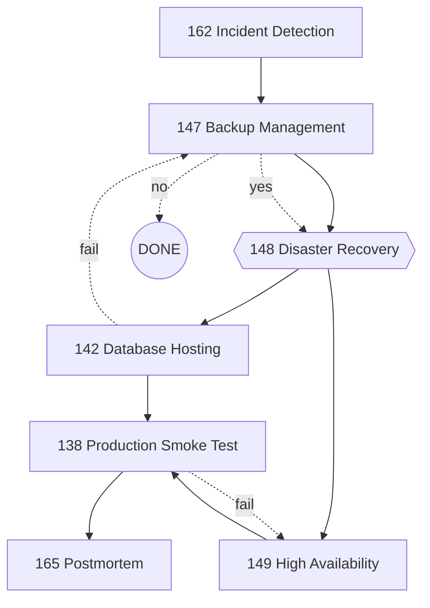

# Disaster recovery

> Generated from `registry/workflows/disaster-recovery.json`. Edit the source, then run `python scripts/build.py`.

**Purpose.** Recover service and data after a regional failure or data loss and measure recovery against targets.

**Trigger.** A region, data store or provider is lost, or a scheduled DR exercise starts.

## Entry criteria
- DR plan and RTO/RPO targets exist
- Backups are available in an isolated location

## Required inputs
- dr_plan
- rto_rpo_targets
- backup_inventory

## Flow

Solid arrows are dependencies, dotted arrows are decisions and failure paths, hexagons need human approval.

## Steps

| # | Stage | Owner (accountable or responsible) | Needs | Notes |
|---:|---|---|---|---|
| 162 | Incident Detection | `incident-manager` | - | Assess scope of loss. |
| 147 | Backup Management | `database-administrator` | 162 | Verify which backup to restore from. |
| 148 | Disaster Recovery | `sre` | 147 | Declare DR and execute the plan.; approval: dr-owner |
| 142 | Database Hosting | `database-administrator` | 148 | Restore data stores. |
| 149 | High Availability | `cloud-architect` | 148 | Fail over or rebuild compute and networking. |
| 138 | Production Smoke Test | `sre` | 142, 149 |  |
| 165 | Postmortem | `incident-manager` | 138 |  |

## Parallel work
- Stages 142, 149

## Human approval points

| Stage | Approver | When |
|---:|---|---|
| 148 Disaster Recovery | `dr-owner` | always |

Rationale for each approval is in `docs/governance/APPROVAL_POLICY.md` and the stage's `approval_rationale`.

## Decision points
- After 147 - Is a usable backup available? **yes** -> 148; **no** -> end

## Failure and remediation

| At stage | Condition | Action | Go to |
|---:|---|---|---|
| 142 | Restore fails integrity checks | Try the previous backup; record data loss window | 147 |
| 138 | Smoke test fails after failover | Hold traffic; investigate before cutover | 149 |

## Outputs
- dr_test_report
- measured_rto_rpo
- postmortem

## Exit criteria
- Measured RTO and RPO are recorded against targets
- Data integrity checks pass
- Gaps in the plan become tracked actions

## Communication
Declare DR to executives and customers; update at fixed intervals.

## Hands off to
- [root-cause-analysis](root-cause-analysis.md)

Any FAIL, BLOCKED or INCONCLUSIVE gate halts the steps that depend on it; see `orchestrator/` for the common failure policy.
