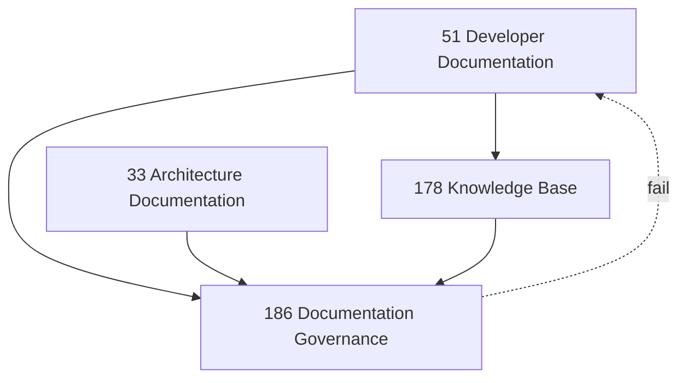

# Documentation update

> Generated from `registry/workflows/documentation-update.json`. Edit the source, then run `python scripts/build.py`.

**Purpose.** Change documentation so it matches behaviour, and publish it with a freshness check.

**Trigger.** Behaviour, architecture or process changed, or documentation is found to be wrong.

## Entry criteria
- The change that makes the docs wrong is identified

## Required inputs
- change_scope
- affected_documents

## Flow

Solid arrows are dependencies, dotted arrows are decisions and failure paths, hexagons need human approval.

## Steps

| # | Stage | Owner (accountable or responsible) | Needs | Notes |
|---:|---|---|---|---|
| 51 | Developer Documentation | `technical-writer` | - | Update the developer-facing docs and run every documented command. |
| 33 | Architecture Documentation | `technical-writer` | - | Only if architecture documents are affected.; optional |
| 178 | Knowledge Base | `technical-writer` | 51 | Only if user-facing support articles are affected.; optional |
| 186 | Documentation Governance | `documentation-engineer` | 51, 33, 178 | Review, link-check and publish; set the next review date. |

## Parallel work
- Stages 33, 51

## Failure and remediation

| At stage | Condition | Action | Go to |
|---:|---|---|---|
| 186 | A documented command fails | Fix the doc or the product; do not publish | 51 |

## Outputs
- updated_documents
- link_check_report

## Exit criteria
- All links resolve
- Every command shown was run and works
- Owner and next review date recorded

## Communication
Announce material changes in the engineering channel.

Any FAIL, BLOCKED or INCONCLUSIVE gate halts the steps that depend on it; see `orchestrator/` for the common failure policy.
