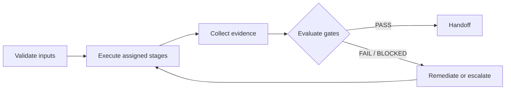

# Emergency Hotfix

> **Outcome:** Every included stage has PASS evidence or an approved, non-expired waiver.

## Trigger
Approved request for emergency hotfix.

## Inputs
- request
- risk classification
- applicable artifacts

## Flow

## Stages and dependencies

**Included stage IDs:** 45, 53, 67, 68, 69, 79, 85, 110, 130, 131, 133, 138, 163, 164, 165.

Stage order and gates are enforced by registry; independent work may run in parallel after prerequisites.

## Roles and skills

| Accountable roles | Control skills |
|---|---|
| project-manager, full-stack-engineer, qa-lead, application-security-engineer, release-manager | master-orchestration, evidence-quality-gates, secure-change-control |

## Parallel tasks
- documentation and test planning after requirements approval

## Approval gates
- business
- requirements
- architecture
- qa
- security
- production-human-approval

## Outputs and evidence

Outputs: versioned artifacts, evidence bundle, final workflow report. Include immutable revision/digest, validation reports, gate statuses, limitations, and handoff receiver.

## Failure handling

Stop unsafe work; mark failed gate; create remediation/rollback path. Never report a completed workflow while a required gate is failing, blocked, or inconclusive.

## Completion criteria

Every included stage has PASS evidence or an approved, non-expired waiver.

## Related controls

- [Master orchestrator](../orchestrator/MASTER_ORCHESTRATOR.md)
- [Evidence gate policy](../orchestrator/policies/GATE_POLICY.md)
- [Standard handoff](../orchestrator/handoff-contracts/STANDARD_HANDOFF.md)
