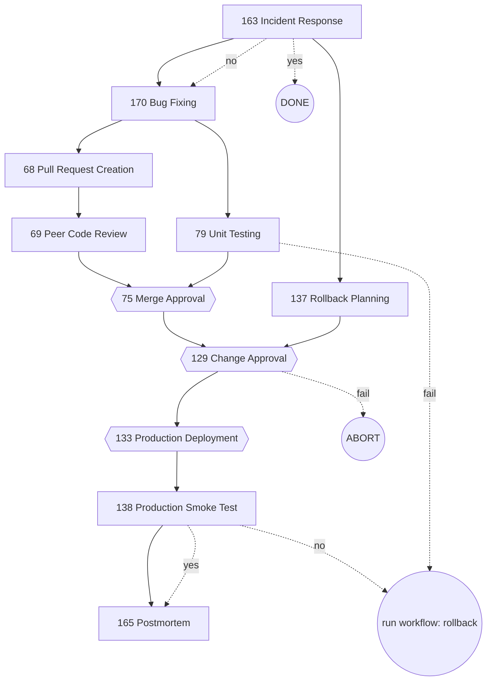

# Emergency hotfix

> Generated from `registry/workflows/emergency-hotfix.json`. Edit the source, then run `python scripts/build.py`.

**Purpose.** Restore service quickly with the minimum change, keeping review and approval, then audit afterwards.

**Trigger.** A Sev1 or Sev2 production incident whose fix needs a code change that cannot wait for the normal release.

## Entry criteria
- Incident declared with an incident commander
- Mitigation without code (flag, rollback, scaling) was considered and is insufficient or unavailable

## Required inputs
- incident_record
- suspected_change_or_component
- rollback_candidate_version

## Flow

Solid arrows are dependencies, dotted arrows are decisions and failure paths, hexagons need human approval.

## Steps

| # | Stage | Owner (accountable or responsible) | Needs | Notes |
|---:|---|---|---|---|
| 163 | Incident Response | `incident-manager` | - |  |
| 137 | Rollback Planning | `release-manager` | 163 | Know the way back before changing production. |
| 170 | Bug Fixing | `backend-engineer` | 163 |  |
| 79 | Unit Testing | `unit-testing-specialist` | 170 |  |
| 68 | Pull Request Creation | `full-stack-engineer` | 170 |  |
| 69 | Peer Code Review | `code-reviewer` | 68 | Compressed to the changed lines; never skipped. |
| 75 | Merge Approval | `merge-steward` | 69, 79 | approval: code-owner |
| 129 | Change Approval | `release-manager` | 75, 137 | Expedited change approval by the on-call change authority.; approval: change-board |
| 133 | Production Deployment | `deployment-engineer` | 129 | approval: production-approver |
| 138 | Production Smoke Test | `sre` | 133 |  |
| 165 | Postmortem | `incident-manager` | 138 | Audit after service is restored. |

## Parallel work
- Stages 137, 170
- Stages 68, 79

## Human approval points

| Stage | Approver | When |
|---:|---|---|
| 75 Merge Approval | `code-owner` | always |
| 129 Change Approval | `change-board` | always |
| 133 Production Deployment | `production-approver` | always |

Rationale for each approval is in `docs/governance/APPROVAL_POLICY.md` and the stage's `approval_rationale`.

## Decision points
- After 163 - Does mitigation without code restore service? **yes** -> end; **no** -> 170
- After 138 - Is service healthy? **yes** -> 165; **no** -> workflow:rollback

## Failure and remediation

| At stage | Condition | Action | Go to |
|---:|---|---|---|
| 79 | New test fails or cannot be written in the time box | Escalate to the incident commander; prefer rollback over an untested fix | workflow:rollback |
| 129 | Approval not granted within the time box | Do not deploy; commander chooses rollback or another mitigation | abort |

## Outputs
- hotfix_release
- incident_timeline
- postmortem
- backport_pr_to_mainline

## Exit criteria
- Service restored and held stable for the agreed observation window
- Post-deploy smoke test passes
- Fix back-ported to the main branch
- Postmortem scheduled with an owner

## Communication
Incident commander posts status at a fixed interval to stakeholders; customer communication follows the incident-response plan.

## Hands off to
- [rollback](rollback.md)
- [root-cause-analysis](root-cause-analysis.md)

Any FAIL, BLOCKED or INCONCLUSIVE gate halts the steps that depend on it; see `orchestrator/` for the common failure policy.
