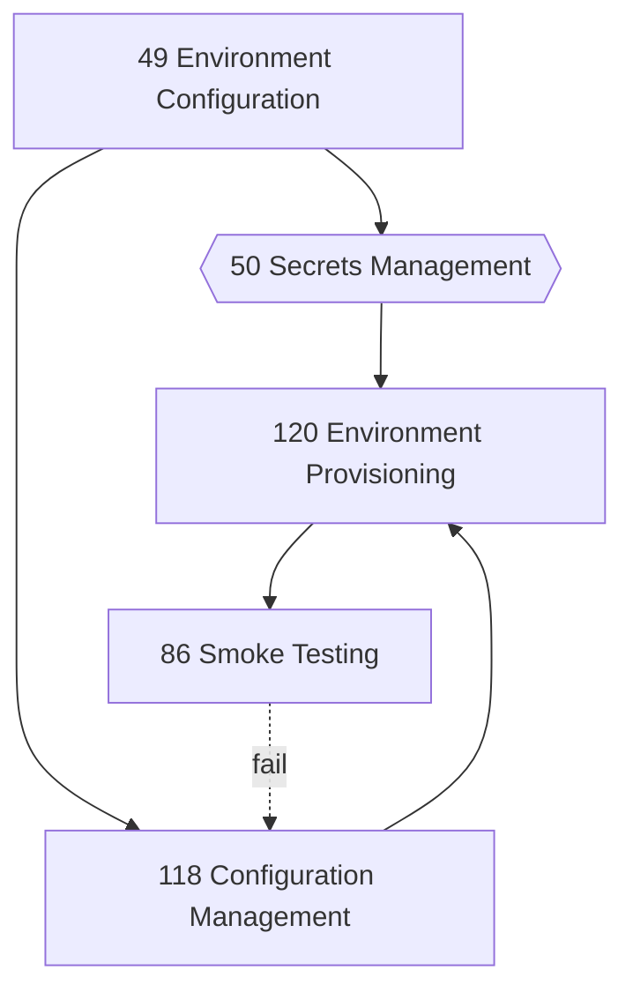

# Environment configuration

> Generated from `registry/workflows/environment-configuration.json`. Edit the source, then run `python scripts/build.py`.

**Purpose.** Define and apply configuration and secrets for an environment without leaking values.

**Trigger.** A new or changed environment setting is required.

## Entry criteria
- Environment exists or is being provisioned

## Required inputs
- environment_requirements
- secret_inventory

## Flow

Solid arrows are dependencies, dotted arrows are decisions and failure paths, hexagons need human approval.

## Steps

| # | Stage | Owner (accountable or responsible) | Needs | Notes |
|---:|---|---|---|---|
| 49 | Environment Configuration | `devops-engineer` | - |  |
| 50 | Secrets Management | `devsecops-engineer` | 49 | Secrets go to the secret store; rotation of production secrets needs approval.; approval: secrets-owner |
| 118 | Configuration Management | `platform-engineer` | 49 |  |
| 120 | Environment Provisioning | `infrastructure-engineer` | 50, 118 |  |
| 86 | Smoke Testing | `automation-qa-engineer` | 120 |  |

## Parallel work
- Stages 50, 118

## Human approval points

| Stage | Approver | When |
|---:|---|---|
| 50 Secrets Management | `secrets-owner` | when rotating or revoking production secrets |

Rationale for each approval is in `docs/governance/APPROVAL_POLICY.md` and the stage's `approval_rationale`.

## Failure and remediation

| At stage | Condition | Action | Go to |
|---:|---|---|---|
| 86 | Smoke test fails after configuration change | Revert the configuration change and investigate | 118 |

## Outputs
- environment_config_matrix
- secret_store_entries
- smoke_test_report

## Exit criteria
- Configuration is in version control; no secret values in repo, logs or reports
- Smoke test passes in the environment

## Communication
Document changed settings for the on-call team.

Any FAIL, BLOCKED or INCONCLUSIVE gate halts the steps that depend on it; see `orchestrator/` for the common failure policy.
