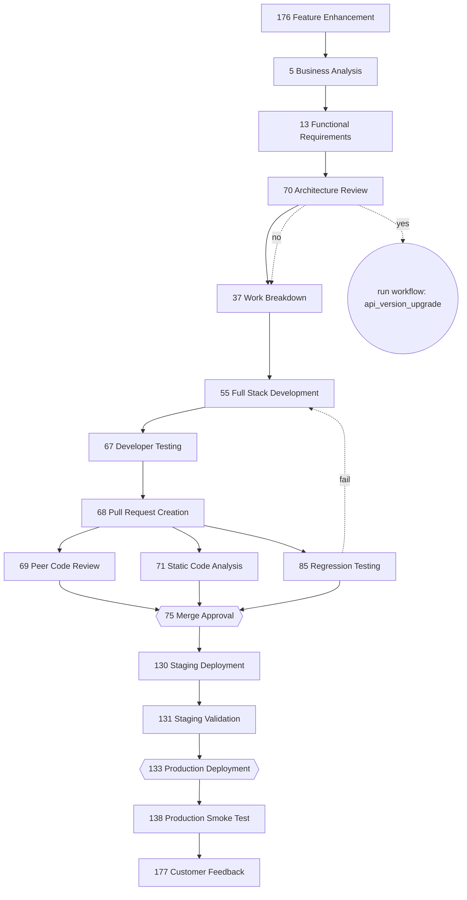

# Existing application enhancement

> Generated from `registry/workflows/existing-application-enhancement.json`. Edit the source, then run `python scripts/build.py`.

**Purpose.** Change behaviour of a live application while protecting what already works.

**Trigger.** A change request alters existing behaviour of a released application.

## Entry criteria
- Change request approved by the product owner
- Current behaviour is documented or characterized by tests

## Required inputs
- change_request
- current_behaviour_baseline

## Flow

Solid arrows are dependencies, dotted arrows are decisions and failure paths, hexagons need human approval.

## Steps

| # | Stage | Owner (accountable or responsible) | Needs | Notes |
|---:|---|---|---|---|
| 176 | Feature Enhancement | `product-owner` | - |  |
| 5 | Business Analysis | `business-analyst` | 176 |  |
| 13 | Functional Requirements | `requirements-engineer` | 5 |  |
| 70 | Architecture Review | `architecture-reviewer` | 13 | Impact on existing architecture and compatibility. |
| 37 | Work Breakdown | `project-manager` | 70 |  |
| 55 | Full Stack Development | `full-stack-engineer` | 37 |  |
| 67 | Developer Testing | `full-stack-engineer` | 55 |  |
| 68 | Pull Request Creation | `full-stack-engineer` | 67 |  |
| 69 | Peer Code Review | `code-reviewer` | 68 |  |
| 71 | Static Code Analysis | `devsecops-engineer` | 68 |  |
| 85 | Regression Testing | `automation-qa-engineer` | 68 | Regression emphasis: existing behaviour must be unchanged unless the request says otherwise. |
| 75 | Merge Approval | `merge-steward` | 69, 71, 85 | approval: code-owner |
| 130 | Staging Deployment | `deployment-engineer` | 75 |  |
| 131 | Staging Validation | `qa-lead` | 130 |  |
| 133 | Production Deployment | `deployment-engineer` | 131 | approval: production-approver |
| 138 | Production Smoke Test | `sre` | 133 |  |
| 177 | Customer Feedback | `product-manager` | 138 |  |

## Parallel work
- Stages 69, 71, 85

## Human approval points

| Stage | Approver | When |
|---:|---|---|
| 75 Merge Approval | `code-owner` | always |
| 133 Production Deployment | `production-approver` | always |

Rationale for each approval is in `docs/governance/APPROVAL_POLICY.md` and the stage's `approval_rationale`.

## Decision points
- After 70 - Does the change break existing consumers? **yes** -> workflow:api-version-upgrade; **no** -> 37

## Failure and remediation

| At stage | Condition | Action | Go to |
|---:|---|---|---|
| 85 | Unintended behaviour change detected | Revert the unintended part or get product-owner approval to accept it | 55 |

## Outputs
- merged_enhancement
- regression_report
- release_record
- feedback_summary

## Exit criteria
- Intended behaviour changed and nothing else
- Regression suite passes
- Customer feedback loop opened

## Communication
Notify users of changed behaviour in release notes.

## Hands off to
- [api-version-upgrade](api-version-upgrade.md)

Any FAIL, BLOCKED or INCONCLUSIVE gate halts the steps that depend on it; see `orchestrator/` for the common failure policy.
