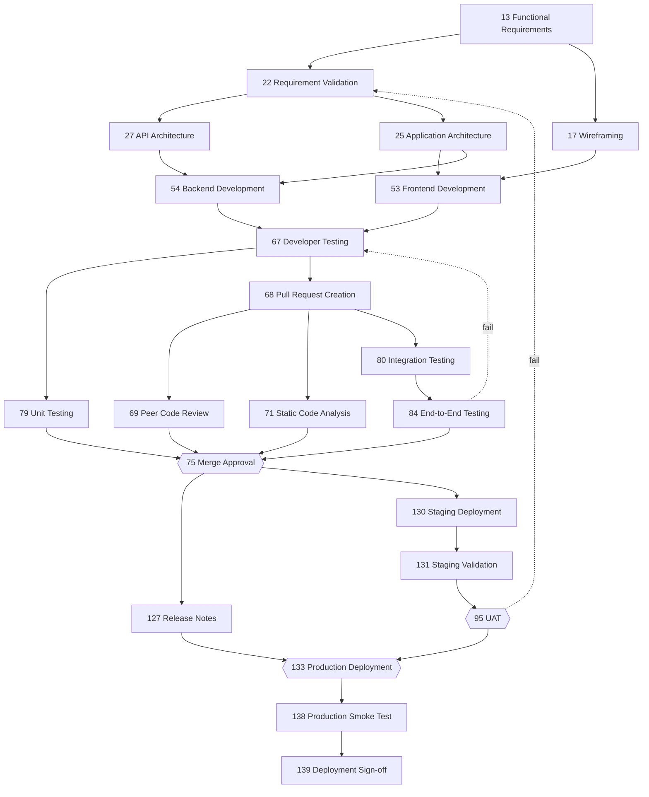

# Feature development

> Generated from `registry/workflows/feature-development.json`. Edit the source, then run `python scripts/build.py`.

**Purpose.** Deliver one bounded capability from approved story to verified release, with tests at every layer.

**Trigger.** An approved backlog item with acceptance criteria is ready.

## Entry criteria
- Story has acceptance criteria
- Design exists if the feature has UI
- Architecture runway is in place

## Required inputs
- user_story
- acceptance_criteria
- ui_designs_if_any

## Flow

Solid arrows are dependencies, dotted arrows are decisions and failure paths, hexagons need human approval.

## Steps

| # | Stage | Owner (accountable or responsible) | Needs | Notes |
|---:|---|---|---|---|
| 13 | Functional Requirements | `requirements-engineer` | - |  |
| 22 | Requirement Validation | `product-owner` | 13 |  |
| 17 | Wireframing | `ui-ux-designer` | 13 | optional |
| 27 | API Architecture | `api-architect` | 22 | optional |
| 25 | Application Architecture | `software-architect` | 22 |  |
| 53 | Frontend Development | `frontend-engineer` | 25, 17 |  |
| 54 | Backend Development | `backend-engineer` | 25, 27 |  |
| 67 | Developer Testing | `full-stack-engineer` | 53, 54 |  |
| 79 | Unit Testing | `unit-testing-specialist` | 67 |  |
| 68 | Pull Request Creation | `full-stack-engineer` | 67 |  |
| 69 | Peer Code Review | `code-reviewer` | 68 |  |
| 71 | Static Code Analysis | `devsecops-engineer` | 68 |  |
| 80 | Integration Testing | `integration-testing-specialist` | 68 |  |
| 84 | End-to-End Testing | `e2e-testing-specialist` | 80 |  |
| 75 | Merge Approval | `merge-steward` | 69, 71, 79, 84 | approval: code-owner |
| 127 | Release Notes | `technical-writer` | 75 |  |
| 130 | Staging Deployment | `deployment-engineer` | 75 |  |
| 131 | Staging Validation | `qa-lead` | 130 |  |
| 95 | UAT | `qa-lead` | 131 | UAT on staging; accepted by the UAT acceptor.; approval: uat-acceptor |
| 133 | Production Deployment | `deployment-engineer` | 95, 127 | approval: production-approver |
| 138 | Production Smoke Test | `sre` | 133 |  |
| 139 | Deployment Sign-off | `release-manager` | 138 |  |

## Parallel work
- Stages 17, 22
- Stages 25, 27
- Stages 53, 54
- Stages 68, 79
- Stages 69, 71, 80
- Stages 127, 130

## Human approval points

| Stage | Approver | When |
|---:|---|---|
| 75 Merge Approval | `code-owner` | always |
| 95 UAT | `uat-acceptor` | always |
| 133 Production Deployment | `production-approver` | always |

Rationale for each approval is in `docs/governance/APPROVAL_POLICY.md` and the stage's `approval_rationale`.

## Failure and remediation

| At stage | Condition | Action | Go to |
|---:|---|---|---|
| 84 | E2E fails | Return to 54/53 with failing trace | 67 |
| 95 | UAT rejected | Capture feedback as new acceptance criteria or defects | 22 |

## Outputs
- merged_feature
- test_reports
- uat_report
- release_notes
- release_record

## Exit criteria
- Each acceptance criterion maps to a passing test
- UAT accepted
- Production smoke test passes

## Communication
Demo to the product owner at UAT; release notes on ship.

Any FAIL, BLOCKED or INCONCLUSIVE gate halts the steps that depend on it; see `orchestrator/` for the common failure policy.
