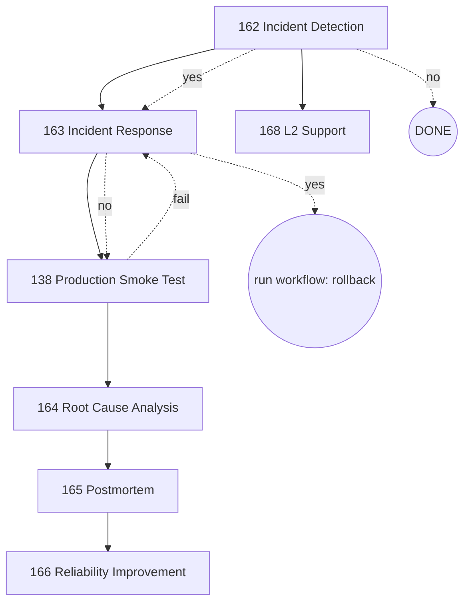

# Incident response

> Generated from `registry/workflows/incident-response.json`. Edit the source, then run `python scripts/build.py`.

**Purpose.** Detect, declare, mitigate, communicate and resolve a production incident, then learn from it.

**Trigger.** An alert fires or a user report indicates degraded or unavailable service.

## Entry criteria
- Alert or report is available with time and scope
- On-call rota is current

## Required inputs
- alert_or_report
- service_ownership
- runbook

## Flow

Solid arrows are dependencies, dotted arrows are decisions and failure paths, hexagons need human approval.

## Steps

| # | Stage | Owner (accountable or responsible) | Needs | Notes |
|---:|---|---|---|---|
| 162 | Incident Detection | `incident-manager` | - | Confirm the signal is real and assign severity. |
| 163 | Incident Response | `incident-manager` | 162 | Declare, mitigate and communicate; keep a timeline. |
| 168 | L2 Support | `production-support-engineer` | 162 | Assess and message customer impact. |
| 138 | Production Smoke Test | `sre` | 163 | Verify recovery against the SLO. |
| 164 | Root Cause Analysis | `sre` | 138 |  |
| 165 | Postmortem | `incident-manager` | 164 |  |
| 166 | Reliability Improvement | `sre` | 165 |  |

## Parallel work
- Stages 163, 168

## Decision points
- After 162 - Is this a real incident? **yes** -> 163; **no** -> end
- After 163 - Is the cause a recent release? **yes** -> workflow:rollback; **no** -> 138

## Failure and remediation

| At stage | Condition | Action | Go to |
|---:|---|---|---|
| 138 | Recovery not confirmed | Keep the incident open and escalate severity | 163 |

## Outputs
- incident_timeline
- customer_communication_log
- rca_report
- postmortem
- reliability_backlog

## Exit criteria
- Service restored and SLO indicators recovered
- Postmortem published with owners and due dates
- Follow-up items tracked in the backlog

## Communication
Status updates at the severity-defined cadence; final customer notice on resolution.

## Hands off to
- [rollback](rollback.md)
- [root-cause-analysis](root-cause-analysis.md)

Any FAIL, BLOCKED or INCONCLUSIVE gate halts the steps that depend on it; see `orchestrator/` for the common failure policy.
