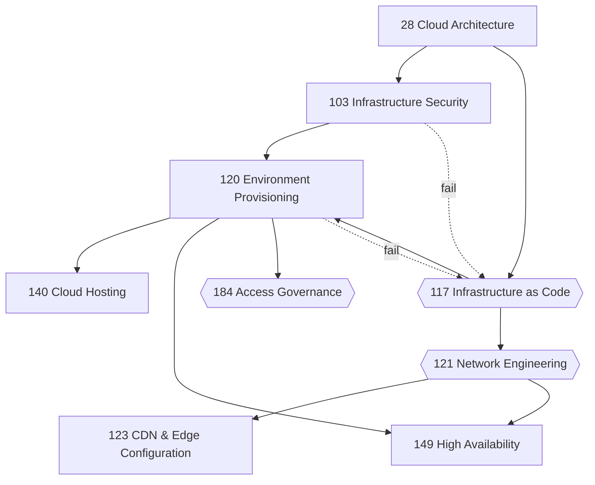

# Infrastructure provisioning

> Generated from `registry/workflows/infrastructure-provisioning.json`. Edit the source, then run `python scripts/build.py`.

**Purpose.** Create or change cloud infrastructure through reviewed code and a reviewed plan.

**Trigger.** A new environment or an infrastructure change is needed.

## Entry criteria
- Cloud architecture approved
- State backend and credentials for non-production exist

## Required inputs
- cloud_architecture
- target_environment
- cost_estimate

## Flow

Solid arrows are dependencies, dotted arrows are decisions and failure paths, hexagons need human approval.

## Steps

| # | Stage | Owner (accountable or responsible) | Needs | Notes |
|---:|---|---|---|---|
| 28 | Cloud Architecture | `cloud-architect` | - |  |
| 103 | Infrastructure Security | `devsecops-engineer` | 28 | Scan IaC before any apply. |
| 117 | Infrastructure as Code | `infrastructure-engineer` | 28 | Write IaC and produce the plan; production apply needs approval.; approval: infra-owner |
| 120 | Environment Provisioning | `infrastructure-engineer` | 103, 117 |  |
| 121 | Network Engineering | `network-engineer` | 117 | Network and firewall rules; production changes need approval.; approval: infra-owner |
| 123 | CDN & Edge Configuration | `platform-engineer` | 121 | optional |
| 140 | Cloud Hosting | `cloud-engineer` | 120 |  |
| 149 | High Availability | `cloud-architect` | 120, 121 |  |
| 184 | Access Governance | `compliance-specialist` | 120 | approval: access-owner |

## Parallel work
- Stages 103, 117
- Stages 120, 121
- Stages 123, 140, 149, 184

## Human approval points

| Stage | Approver | When |
|---:|---|---|
| 117 Infrastructure as Code | `infra-owner` | before applying a plan to production; always when the plan destroys resources or changes IAM |
| 121 Network Engineering | `infra-owner` | for production firewall, security-group or routing changes |
| 184 Access Governance | `access-owner` | when granting or widening privileged or break-glass access, or revoking access in bulk |

Rationale for each approval is in `docs/governance/APPROVAL_POLICY.md` and the stage's `approval_rationale`.

## Failure and remediation

| At stage | Condition | Action | Go to |
|---:|---|---|---|
| 103 | IaC scan reports a critical issue | Fix the code; no apply | 117 |
| 120 | Apply fails midway | Do not retry blindly; inspect state, then re-plan | 117 |

## Outputs
- iac_code
- plan_output
- provisioned_environment
- access_review

## Exit criteria
- Plan reviewed by a human before production apply
- Drift check clean after apply
- Access reviewed; cost within estimate

## Communication
Tell dependent teams when the environment is ready.

Any FAIL, BLOCKED or INCONCLUSIVE gate halts the steps that depend on it; see `orchestrator/` for the common failure policy.
