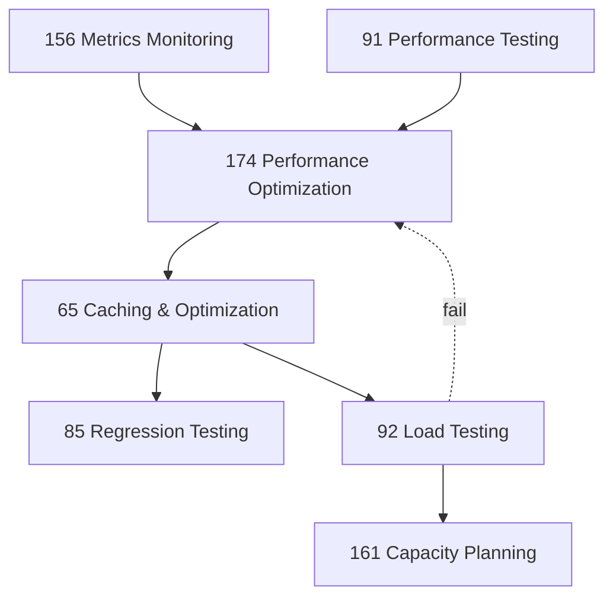

# Performance optimization

> Generated from `registry/workflows/performance-optimization.json`. Edit the source, then run `python scripts/build.py`.

**Purpose.** Improve a measured bottleneck and prove the improvement on the same workload.

**Trigger.** An SLO breach, capacity risk or performance regression is observed.

## Entry criteria
- A repeatable workload exists
- A baseline can be measured

## Required inputs
- performance_baseline
- slo_targets

## Flow

Solid arrows are dependencies, dotted arrows are decisions and failure paths, hexagons need human approval.

## Steps

| # | Stage | Owner (accountable or responsible) | Needs | Notes |
|---:|---|---|---|---|
| 156 | Metrics Monitoring | `observability-engineer` | - |  |
| 91 | Performance Testing | `performance-testing-specialist` | - |  |
| 174 | Performance Optimization | `performance-engineer` | 156, 91 |  |
| 65 | Caching & Optimization | `performance-engineer` | 174 |  |
| 85 | Regression Testing | `automation-qa-engineer` | 65 |  |
| 92 | Load Testing | `performance-testing-specialist` | 65 |  |
| 161 | Capacity Planning | `sre` | 92 |  |

## Parallel work
- Stages 91, 156
- Stages 85, 92

## Failure and remediation

| At stage | Condition | Action | Go to |
|---:|---|---|---|
| 92 | No measurable improvement | Revert the change; record the finding | 174 |

## Outputs
- before_after_benchmarks
- optimization_changes
- capacity_plan_update

## Exit criteria
- Improvement measured on the same workload
- No functional regression

## Communication
Report before and after numbers to the service owner.

Any FAIL, BLOCKED or INCONCLUSIVE gate halts the steps that depend on it; see `orchestrator/` for the common failure policy.
