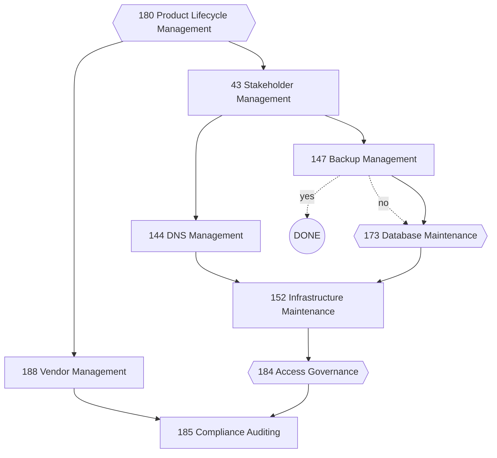

# Product retirement

> Generated from `registry/workflows/product-retirement.json`. Edit the source, then run `python scripts/build.py`.

**Purpose.** Sunset a product with notice, data export, decommissioning, access revocation and audit.

**Trigger.** The business approves retiring a product or major component.

## Entry criteria
- Retirement decision documented
- Contractual notice periods known

## Required inputs
- retirement_decision
- customer_list
- contract_inventory
- data_retention_policy

## Flow

Solid arrows are dependencies, dotted arrows are decisions and failure paths, hexagons need human approval.

## Steps

| # | Stage | Owner (accountable or responsible) | Needs | Notes |
|---:|---|---|---|---|
| 180 | Product Lifecycle Management | `product-manager` | - | Plan, and obtain sponsor approval.; approval: business-sponsor |
| 43 | Stakeholder Management | `program-manager` | 180 | Notify customers and internal stakeholders. |
| 188 | Vendor Management | `vendor-management-specialist` | 180 | Give notice on vendor contracts. |
| 147 | Backup Management | `database-administrator` | 43 | Export and archive data per retention policy. |
| 173 | Database Maintenance | `database-administrator` | 147 | Delete data after the retention hold; destructive, approval required.; approval: dba-owner |
| 144 | DNS Management | `network-engineer` | 43 |  |
| 152 | Infrastructure Maintenance | `infrastructure-engineer` | 173, 144 | Decommission compute, storage and DNS. |
| 184 | Access Governance | `compliance-specialist` | 152 | Revoke access; approval by the access owner.; approval: access-owner |
| 185 | Compliance Auditing | `security-auditor` | 184, 188 |  |

## Parallel work
- Stages 43, 188
- Stages 144, 147

## Human approval points

| Stage | Approver | When |
|---:|---|---|
| 180 Product Lifecycle Management | `business-sponsor` | always |
| 173 Database Maintenance | `dba-owner` | for destructive or locking maintenance on production data |
| 184 Access Governance | `access-owner` | when granting or widening privileged or break-glass access, or revoking access in bulk |

Rationale for each approval is in `docs/governance/APPROVAL_POLICY.md` and the stage's `approval_rationale`.

## Decision points
- After 147 - Is any legal or retention hold active? **yes** -> end; **no** -> 173

## Failure and remediation

| At stage | Condition | Action | Go to |
|---:|---|---|---|
| 184 | Residual access found | Revoke and re-audit before closing | 184 |

## Outputs
- retirement_plan
- data_disposition_record
- access_revocation_record
- audit_report

## Exit criteria
- Customers notified within contract terms
- Data archived or deleted with recorded approval
- All access and credentials revoked
- Recurring cost stopped

## Communication
Customer notice schedule; internal announcement at decommission.

Any FAIL, BLOCKED or INCONCLUSIVE gate halts the steps that depend on it; see `orchestrator/` for the common failure policy.
