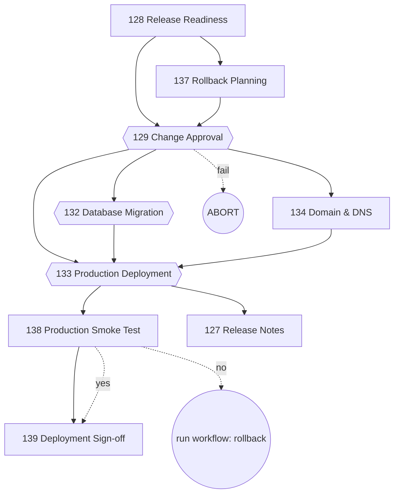

# Production release

> Generated from `registry/workflows/production-release.json`. Edit the source, then run `python scripts/build.py`.

**Purpose.** Release a validated artifact to production with approval, a tested way back, and verification.

**Trigger.** A release candidate has passed staging validation and readiness review.

## Entry criteria
- Staging validation report for the same artifact version
- QA and security sign-offs exist

## Required inputs
- release_readiness_report
- artifact_version
- rollback_plan

## Flow

Solid arrows are dependencies, dotted arrows are decisions and failure paths, hexagons need human approval.

## Steps

| # | Stage | Owner (accountable or responsible) | Needs | Notes |
|---:|---|---|---|---|
| 128 | Release Readiness | `release-manager` | - |  |
| 137 | Rollback Planning | `release-manager` | 128 |  |
| 129 | Change Approval | `release-manager` | 128, 137 | Change board approval.; approval: change-board |
| 132 | Database Migration | `database-administrator` | 129 | optional; approval: dba-owner |
| 134 | Domain & DNS | `cloud-engineer` | 129 | optional |
| 133 | Production Deployment | `deployment-engineer` | 129, 132, 134 | Approval by the production approver for this artifact version.; approval: production-approver |
| 138 | Production Smoke Test | `sre` | 133 |  |
| 139 | Deployment Sign-off | `release-manager` | 138 |  |
| 127 | Release Notes | `technical-writer` | 133 | Publish release notes. |

## Parallel work
- Stages 132, 134
- Stages 127, 138

## Human approval points

| Stage | Approver | When |
|---:|---|---|
| 129 Change Approval | `change-board` | always |
| 132 Database Migration | `dba-owner` | always |
| 133 Production Deployment | `production-approver` | always |

Rationale for each approval is in `docs/governance/APPROVAL_POLICY.md` and the stage's `approval_rationale`.

## Decision points
- After 138 - Smoke test passed? **yes** -> 139; **no** -> workflow:rollback

## Failure and remediation

| At stage | Condition | Action | Go to |
|---:|---|---|---|
| 129 | Change not approved | Stop; record the decision and reasons | abort |

## Outputs
- release_record
- production_smoke_report
- published_release_notes

## Exit criteria
- Production approver approved the exact artifact version
- Smoke test and health checks pass
- Release record lists version, time and approver

## Communication
Announce window and completion to stakeholders.

## Hands off to
- [rollback](rollback.md)

Any FAIL, BLOCKED or INCONCLUSIVE gate halts the steps that depend on it; see `orchestrator/` for the common failure policy.
