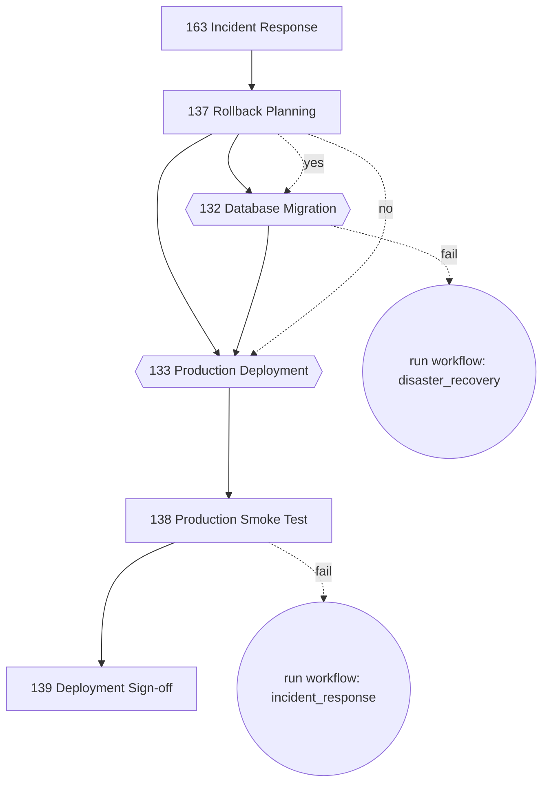

# Rollback

> Generated from `registry/workflows/rollback.json`. Edit the source, then run `python scripts/build.py`.

**Purpose.** Return production to the last known good version and prove it is healthy.

**Trigger.** A production release fails verification, or a Sev1 regression is traced to the latest release.

## Entry criteria
- Last known good artifact version identified
- Incident commander named

## Required inputs
- failed_release_version
- last_known_good_version
- rollback_plan

## Flow

Solid arrows are dependencies, dotted arrows are decisions and failure paths, hexagons need human approval.

## Steps

| # | Stage | Owner (accountable or responsible) | Needs | Notes |
|---:|---|---|---|---|
| 163 | Incident Response | `incident-manager` | - |  |
| 137 | Rollback Planning | `release-manager` | 163 | Confirm the rollback plan matches what was actually deployed. |
| 132 | Database Migration | `database-administrator` | 137 | Only if the failed release changed the schema or data.; optional; approval: dba-owner |
| 133 | Production Deployment | `deployment-engineer` | 137, 132 | Redeploy the last known good artifact.; approval: production-approver |
| 138 | Production Smoke Test | `sre` | 133 |  |
| 139 | Deployment Sign-off | `release-manager` | 138 |  |

## Human approval points

| Stage | Approver | When |
|---:|---|---|
| 132 Database Migration | `dba-owner` | always |
| 133 Production Deployment | `production-approver` | always |

Rationale for each approval is in `docs/governance/APPROVAL_POLICY.md` and the stage's `approval_rationale`.

## Decision points
- After 137 - Did the failed release change the database? **yes** -> 132; **no** -> 133

## Failure and remediation

| At stage | Condition | Action | Go to |
|---:|---|---|---|
| 138 | Smoke test fails on the rolled-back version | Escalate to incident-response; consider rolling back one more version | workflow:incident-response |
| 132 | Data cannot be reverted safely | Stop; DBA owner and incident commander choose forward-fix or restore from backup | workflow:disaster-recovery |

## Outputs
- rollback_record
- production_smoke_report
- incident_note

## Exit criteria
- Production runs the last known good version
- Smoke test and health checks pass
- Data impact assessed and recorded
- Failed release version blocked from redeploy

## Communication
Announce rollback start and completion in the incident channel; notify affected customers if the failure was user visible.

## Hands off to
- [incident-response](incident-response.md)
- [root-cause-analysis](root-cause-analysis.md)

Any FAIL, BLOCKED or INCONCLUSIVE gate halts the steps that depend on it; see `orchestrator/` for the common failure policy.
