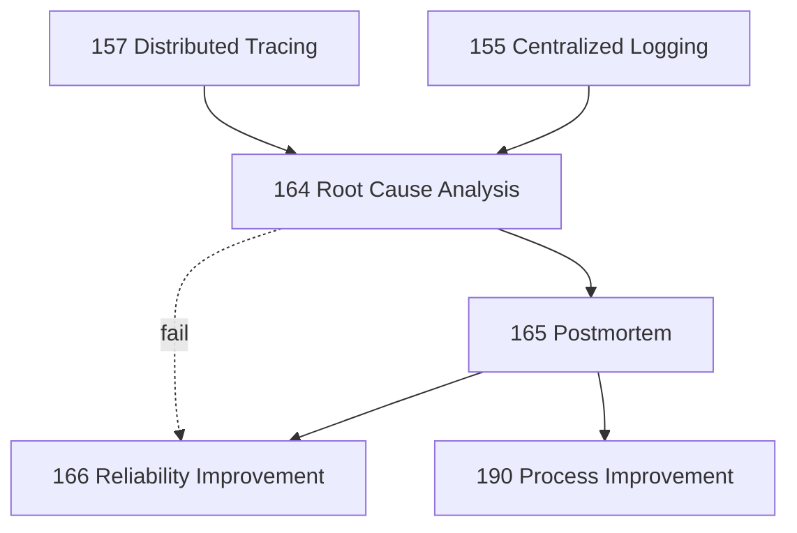

# Root cause analysis

> Generated from `registry/workflows/root-cause-analysis.json`. Edit the source, then run `python scripts/build.py`.

**Purpose.** Find evidence-backed causes of an incident or recurring defect and turn them into fixes.

**Trigger.** An incident is resolved or a defect keeps recurring.

## Entry criteria
- Incident timeline or defect history exists
- Logs and traces cover the time window

## Required inputs
- incident_timeline
- logs
- traces
- metrics

## Flow

Solid arrows are dependencies, dotted arrows are decisions and failure paths, hexagons need human approval.

## Steps

| # | Stage | Owner (accountable or responsible) | Needs | Notes |
|---:|---|---|---|---|
| 155 | Centralized Logging | `observability-engineer` | - |  |
| 157 | Distributed Tracing | `observability-engineer` | - |  |
| 164 | Root Cause Analysis | `sre` | 155, 157 |  |
| 165 | Postmortem | `incident-manager` | 164 |  |
| 166 | Reliability Improvement | `sre` | 165 |  |
| 190 | Process Improvement | `process-improvement-specialist` | 165 |  |

## Parallel work
- Stages 155, 157
- Stages 166, 190

## Failure and remediation

| At stage | Condition | Action | Go to |
|---:|---|---|---|
| 164 | Evidence is missing | Record the gap as an action; do not guess a cause | 166 |

## Outputs
- rca_report
- blameless_postmortem
- reliability_backlog
- process_improvements

## Exit criteria
- Each cause is backed by evidence; hypotheses are labelled
- Every action has an owner and due date

## Communication
Share the postmortem broadly; review actions monthly.

Any FAIL, BLOCKED or INCONCLUSIVE gate halts the steps that depend on it; see `orchestrator/` for the common failure policy.
