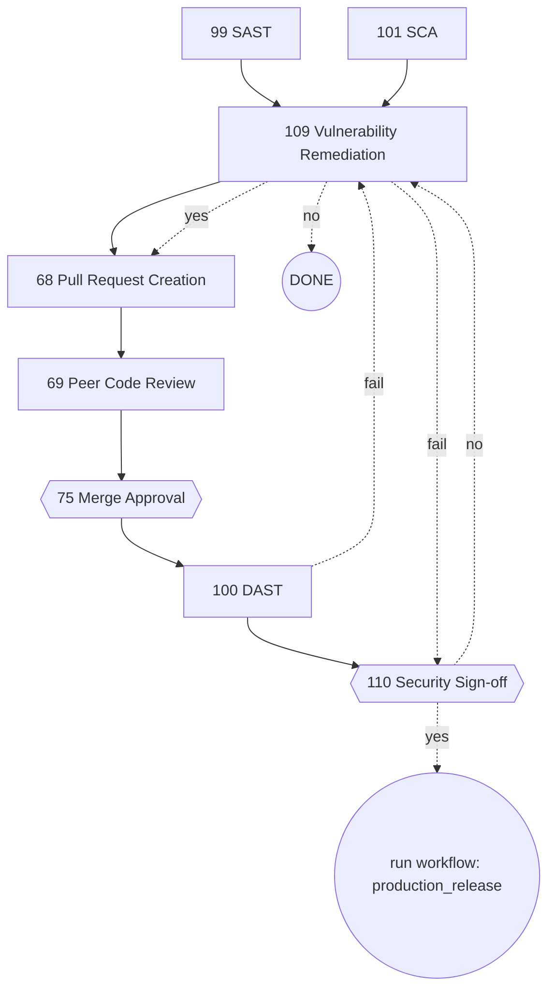

# Security vulnerability remediation

> Generated from `registry/workflows/security-vulnerability-remediation.json`. Edit the source, then run `python scripts/build.py`.

**Purpose.** Remove a validated vulnerability and prove the fix with independent retesting.

**Trigger.** A scanner, pentest, advisory or disclosure reports a vulnerability in code or dependencies.

## Entry criteria
- Finding has an affected component and location
- Suspected findings are marked needs-validation, not confirmed

## Required inputs
- finding_report
- affected_component
- severity_estimate

## Flow

Solid arrows are dependencies, dotted arrows are decisions and failure paths, hexagons need human approval.

## Steps

| # | Stage | Owner (accountable or responsible) | Needs | Notes |
|---:|---|---|---|---|
| 99 | SAST | `devsecops-engineer` | - | Re-scan code to confirm the finding on the current commit. |
| 101 | SCA | `devsecops-engineer` | - | Re-scan dependencies and produce the SBOM. |
| 109 | Vulnerability Remediation | `application-security-engineer` | 99, 101 | Triage to confirmed / rejected, then patch with a test that fails before the fix. |
| 68 | Pull Request Creation | `full-stack-engineer` | 109 |  |
| 69 | Peer Code Review | `code-reviewer` | 68 |  |
| 75 | Merge Approval | `merge-steward` | 69 | approval: code-owner |
| 100 | DAST | `devsecops-engineer` | 75 | Retest in a test environment by someone other than the fixer. |
| 110 | Security Sign-off | `security-auditor` | 100 | Independent sign-off against the original finding.; approval: security-lead |

## Parallel work
- Stages 99, 101

## Human approval points

| Stage | Approver | When |
|---:|---|---|
| 75 Merge Approval | `code-owner` | always |
| 110 Security Sign-off | `security-lead` | always |

Rationale for each approval is in `docs/governance/APPROVAL_POLICY.md` and the stage's `approval_rationale`.

## Decision points
- After 109 - Is the finding confirmed? **yes** -> 68; **no** -> end
- After 110 - Sign-off granted? **yes** -> workflow:production-release; **no** -> 109

## Failure and remediation

| At stage | Condition | Action | Go to |
|---:|---|---|---|
| 100 | Retest still reproduces the issue | Return to 109; do not mark Remediated | 109 |
| 109 | No safe fix available in the needed time | Record Accepted risk with compensating controls for the security lead to approve | 110 |

## Outputs
- findings_register
- remediation_pr
- retest_report
- security_signoff

## Exit criteria
- Each finding is Remediated, Rejected with evidence, or Accepted risk with a named approver
- Retest evidence references the fixed commit SHA
- No new critical or high finding introduced

## Communication
Notify the security lead on confirmation; coordinate any external disclosure with the security lead, not the agent.

## Hands off to
- [production-release](production-release.md)

Any FAIL, BLOCKED or INCONCLUSIVE gate halts the steps that depend on it; see `orchestrator/` for the common failure policy.
