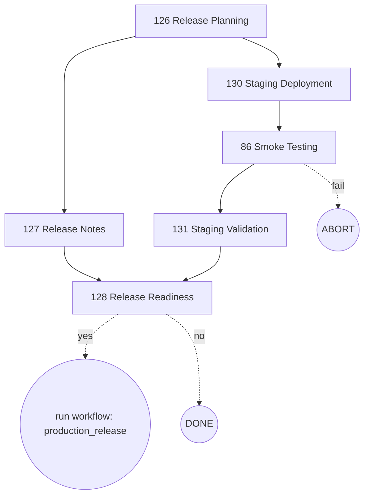

# Staging release

> Generated from `registry/workflows/staging-release.json`. Edit the source, then run `python scripts/build.py`.

**Purpose.** Deploy a release candidate to staging and decide whether it is ready for production.

**Trigger.** A merged change set is ready to be validated as a release candidate.

## Entry criteria
- Artifact is built once and versioned
- QA and security evidence for the commit exists

## Required inputs
- release_candidate_artifact
- qa_evidence
- security_evidence

## Flow

Solid arrows are dependencies, dotted arrows are decisions and failure paths, hexagons need human approval.

## Steps

| # | Stage | Owner (accountable or responsible) | Needs | Notes |
|---:|---|---|---|---|
| 126 | Release Planning | `release-manager` | - |  |
| 127 | Release Notes | `technical-writer` | 126 |  |
| 130 | Staging Deployment | `deployment-engineer` | 126 |  |
| 86 | Smoke Testing | `automation-qa-engineer` | 130 |  |
| 131 | Staging Validation | `qa-lead` | 86 |  |
| 128 | Release Readiness | `release-manager` | 131, 127 |  |

## Parallel work
- Stages 127, 130

## Decision points
- After 128 - Ready for production? **yes** -> workflow:production-release; **no** -> end

## Failure and remediation

| At stage | Condition | Action | Go to |
|---:|---|---|---|
| 86 | Smoke test fails in staging | Block the release; return to the owning change | abort |

## Outputs
- staging_deployment_record
- staging_validation_report
- release_readiness_report

## Exit criteria
- The exact artifact version is validated in staging
- Readiness report references QA and security sign-off

## Communication
Share the readiness report with the change board.

## Hands off to
- [production-release](production-release.md)

Any FAIL, BLOCKED or INCONCLUSIVE gate halts the steps that depend on it; see `orchestrator/` for the common failure policy.
