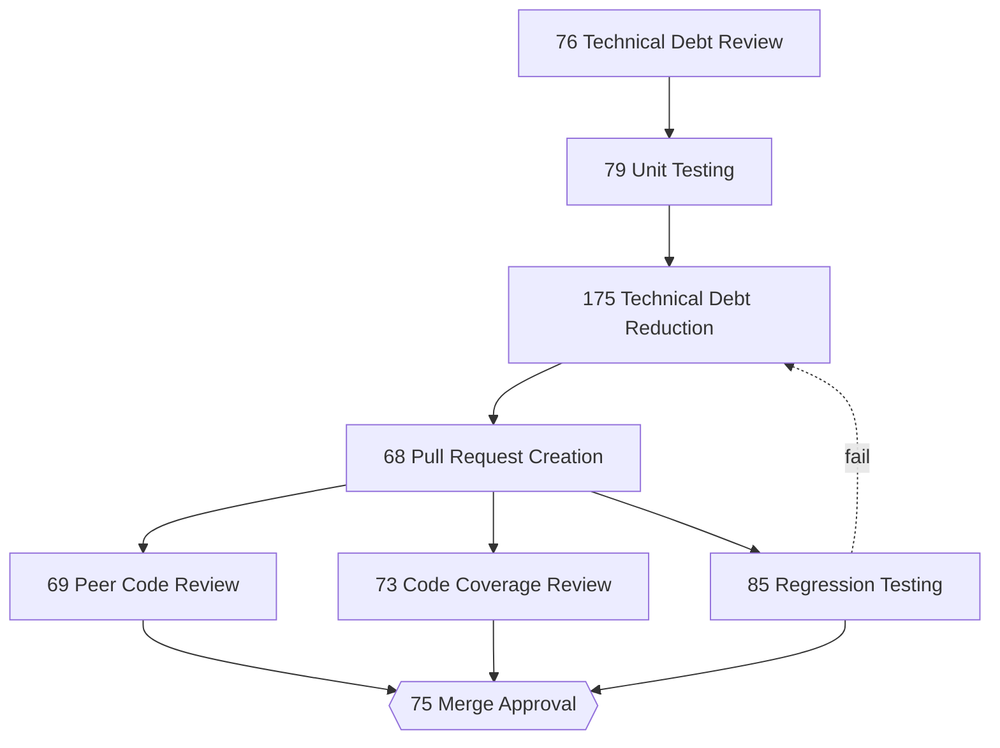

# Technical debt reduction

> Generated from `registry/workflows/technical-debt-reduction.json`. Edit the source, then run `python scripts/build.py`.

**Purpose.** Pay down a prioritized debt item without changing behaviour.

**Trigger.** A debt item is prioritized in the debt register.

## Entry criteria
- Debt item has a clear definition of done

## Required inputs
- technical_debt_register
- target_item

## Flow

Solid arrows are dependencies, dotted arrows are decisions and failure paths, hexagons need human approval.

## Steps

| # | Stage | Owner (accountable or responsible) | Needs | Notes |
|---:|---|---|---|---|
| 76 | Technical Debt Review | `software-architect` | - |  |
| 79 | Unit Testing | `unit-testing-specialist` | 76 | Characterization tests before changing code. |
| 175 | Technical Debt Reduction | `backend-engineer` | 79 |  |
| 68 | Pull Request Creation | `full-stack-engineer` | 175 |  |
| 69 | Peer Code Review | `code-reviewer` | 68 |  |
| 73 | Code Coverage Review | `code-reviewer` | 68 |  |
| 85 | Regression Testing | `automation-qa-engineer` | 68 |  |
| 75 | Merge Approval | `merge-steward` | 69, 73, 85 | approval: code-owner |

## Parallel work
- Stages 69, 73, 85

## Human approval points

| Stage | Approver | When |
|---:|---|---|
| 75 Merge Approval | `code-owner` | always |

Rationale for each approval is in `docs/governance/APPROVAL_POLICY.md` and the stage's `approval_rationale`.

## Failure and remediation

| At stage | Condition | Action | Go to |
|---:|---|---|---|
| 85 | Behaviour changed | Revert; behaviour change is out of scope | 175 |

## Outputs
- debt_reduction_pr
- coverage_assessment
- updated_debt_register

## Exit criteria
- Tests green before and after
- Debt register updated

## Communication
Note refactors in the changelog.

Any FAIL, BLOCKED or INCONCLUSIVE gate halts the steps that depend on it; see `orchestrator/` for the common failure policy.
